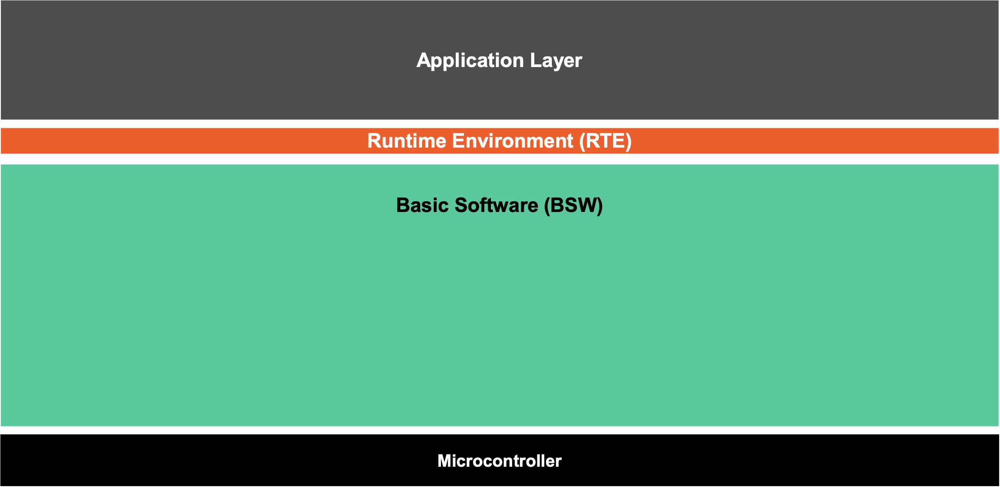
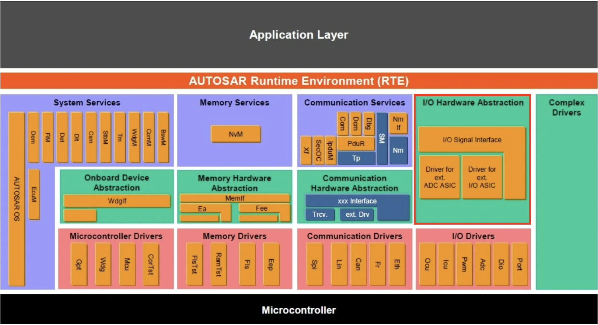

## AUTOSAR Layered Architecture

This document explains what AUTOSAR is, the software architecture of AUTOSAR Classic, and how applications (SWCs) execute on the AUTOSAR platform.

### What is AUTOSAR
AUTOSAR (AUTomotive Open System ARchitecture) is an industry standard developed by OEMs and Tier‑1 suppliers to standardize ECU software architecture.

Main goals:
- Standardize software architecture for reuse.
- Provide HW–SW abstraction so software is independent of ECU layout.

Two main AUTOSAR platforms:
- Classic Platform (CP): for real‑time ECUs with limited resources.
- Adaptive Platform (AP): for high‑performance ECUs (Linux/QNX), supporting dynamic updates.

This article focuses on AUTOSAR Classic.

### AUTOSAR Classic Software Architecture
AUTOSAR Classic is organized into three main layers: Application (SWC), Runtime Environment (RTE), and Basic Software (BSW).



Why layered? This because classic targets real‑time, deterministic embedded control. Layered architecture enforces clear call relationships (deterministic behavior). Service‑oriented approaches (using brokers/queues) can introduce overhead and nondeterminism unsuitable for strict real‑time constraints.

### Layers

- Application (Software Components — SWC)
  Contains functional logic. SWCs have Ports and Runnables and interact with the rest via RTE‑generated APIs.

- Runtime Environment (RTE)
  Generated middleware that connects SWCs and BSW, hiding hardware details and enabling SWC reuse across ECUs.

- Basic Software (BSW)
  Platform services divided into:
  - MCAL (Microcontroller Abstraction Layer): MCU drivers, make higher software layers independent of µC.
  - ECU Abstraction Layer: External peripheral drivers, make higher software layers independent of ECU hardware layout
  - Service Layer: The highest layer of the Basic Software, offer services like communication management, memory services,...
  - Complex Drivers: Integration of non‑AUTOSAR modules with strict timing needs.

Simple IO is handled in ECU Abstraction(do not have service layer for IO) because it typically needs only read/write, avoiding extra overhead that could threaten real‑time behavior.



### How ECU executes AUTOSAR applications
An AUTOSAR ECU runs on an RTOS. OS tasks invoke Runnables via RTE, according to the port/runnable configuration generated by vendor tools.

Example RTE APIs and runnable wrappers:
```c
/* Code generated based on ports configuration of SWC */
Std_ReturnType Rte_Read_PowerControlComponent_Speed(float32* data);
Std_ReturnType Rte_Write_PowerControlComponent_TorqueRequest(float32 data);

/* Periodic Runnable wrapper */
void Rte_PowerControlComponent_Runnable_10ms(void);

/* Event Runnable wrapper */
void Rte_PowerControlComponent_Runnable_SpeedUpdate(void);

/* Runable prototype */
void PowerControlComponent_Runnable_10ms(void);
void PowerControlComponent_Runnable_SpeedUpdate(void);
```

Example SWC implementation:
```c
#include "Rte_PowerControlComponent.h"

static float32 lastSpeed = 0;

void PowerControlComponent_Runnable_SpeedUpdate(void)
{
  Rte_Read_PowerControlComponent_Speed(&lastSpeed);
}

void PowerControlComponent_Runnable_10ms(void)
{
  float32 torque = 0.0f;

  if (lastSpeed > 40.0f)
    torque = 150.0f;
  else
    torque = 80.0f;

  Rte_Write_PowerControlComponent_TorqueRequest(torque);
}
```

RTE wrapper calls the SWC logic:
```c
void Rte_PowerControlComponent_Runnable_SpeedUpdate(void)
{
  PowerControlComponent_Runnable_SpeedUpdate();
}

void Rte_PowerControlComponent_Runnable_10ms(void)
{
  PowerControlComponent_Runnable_10ms();
}
```

Mapping to OS task:
```c
void Rte_Task_10ms(void)
{
  Rte_PowerControlComponent_Runnable_10ms();
}

TASK(Task_10ms)
{
  Rte_Task_10ms();
}
```

On new CAN data:
```c
void Rte_Event_NewVehicleSpeedValue(float32 receivedValue)
{
  extern float32 Rte_Buffer_VehicleSpeed;
  Rte_Buffer_VehicleSpeed = receivedValue;
  Rte_PowerControlComponent_Runnable_SpeedUpdate();
}
```

Processing sequences (summary):
```
Event‑triggered:
==================== Event trigger task ====================
CAN Bus
   │
   ▼
[MCAL CanDrv]
   │  (interrupt)
   ▼
[CanIf] ───► [PduR] ───► [COM Stack]
                                   │
                                   ▼
                              RTE Buffer Updated
                                   │
                                   ▼
                      OS activates Runnable event
                                   │
                                   ▼
                  Rte_PowerControlComponent_Runnable_SpeedUpdate()
                                   │
                                   ▼
              PowerControlComponent_Runnable_SpeedUpdate()
                                   │
                                   ▼
                           (Application logic)

Periodic:
==================== Periodic task ====================
System Timer Interrupt
          │
          ▼
     AUTOSAR OS
          │ triggers Alarm
          ▼
      Task_10ms
          │
          ▼
Rte_PowerControlComponent_Runnable_10ms()
          │
          ▼
PowerControlComponent_Runnable_10ms()
          │
          ▼
 Rte_Write(TorqueRequest)
          │
          ▼
        COM Stack
          │
          ▼
        PduR
          │
          ▼
       CanIf → CanDrv → CAN Bus
```

Because RTE implements the communication APIs, SWCs are independent of whether communication is intra‑ECU or inter‑ECU, facilitating reuse.