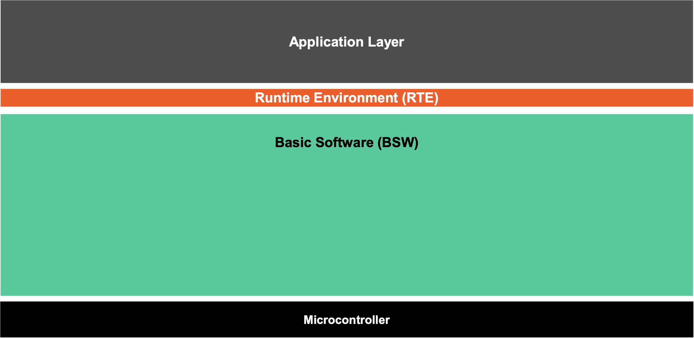
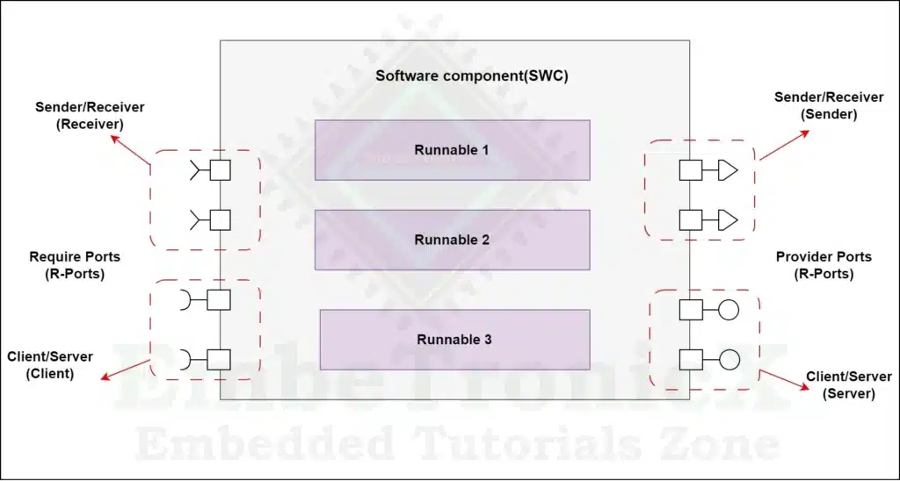
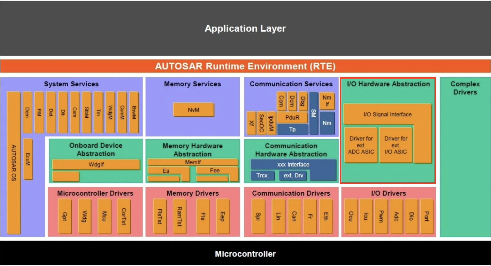

# Autosar Layered Architecture
Trong bài viết này, mình sẽ cùng nhau đi tìm hiểu Autosar là gì, kiến trúc phần mềm của Autosar cũng như cách các application được chạy trên nền tảng Autosar.

## Autosar là gì
Autosar (Automotive Open System Architecture) là một chuẩn (standard) trong ngành công nghiệp ô tô, được tạo ra bởi các hãng xe và nhà cung cấp linh kiện (OEM/Tier1) nhằm chuẩn hóa phần mềm điều khiển trên ECU.

Autosar ra đời để giải quyết 3 vấn đề chính trong phát triển phần mềm điều khiển ô tô:
- Chuẩn hóa kiến trúc phần mềm: Trước khi có Autosar, mỗi hãng viết phần mềm theo kiểu riêng, do đó việc reuse là rất khó khăn.
- Tạo abstraction layer (phân cách HW–SW): Mỗi ECU cấu trúc khác nhau nên việc tích hợp khó khăn. Việc phân tách HW-SW giúp việc reuse phần mềm trở nên dễ dàng hơn.

Hiện Autosar chia thành 2 nền tảng chính:
- Classic Platform (CP): Được dùng với ECU real-time, tài nguyên hạn chế.
- Adaptive Platform (AP): Được dùng với ECU mạnh, hỗ trợ OS Linux/QNX, ứng dụng update online.

Ở bài viết này ta sẽ đi tìm hiểu về kiến trúc phần mềm của Autosar Classic

## Autosar Classic Software Architecture
Kiến trúc phần mềm của hệ thống xây dựng trên chuẩn Autosar bao gồm 3 lớp, bao gồm Basic Software(BSW), Runtime Enviroment(RTE) và Applications.



Câu hỏi đặt ra là, tại sao kiến trúc phần mềm trong chuẩn Autosar Classic lại là ```Layered Architecture```? Trong khi kiến trúc trong chuẩn Autosar Adaptive lại là Service-Oriented-Architecture(SOA)?

Câu trả lời nằm ở mục đích thiết kế của chuẩn Autosar Classic là dành cho ECU với chức năng điều khiển mà ở đó tính real-time và determinism là yếu tố quan trọng.

Layered Architecture trong software engineering là một kiểu kiến trúc trong đó các thành phần (modules) được tổ chức theo dạng tầng (layers), nơi mỗi thành phần có một vị trí trong hệ thống cấp bậc và chỉ tương tác theo các nguyên tắc nhất định, ví dụ chỉ tầng trên được phép gọi các API của tầng dưới. Điều này có nghĩa là tính đúng đắn(deterministic behavior) được kiểm soát, khi ta biết rõ được module nào sẽ gọi API của module nào. Trong khi đó, với kiến trúc SOA, một event có thể được xử lý bởi n-modules và thứ tự xử lý không được đảm bảo do các xử lý còn phải thông qua các thành phần như ```Message broker``` hay ```Queue```. Hơn nữa, việc event được xử lý thông qua các thành phần trung gian ở trên khiến cho thời gian xử lý bị overhead, khó đảm bảo tính real-time trong hệ thống nhúng. Trong khi đó, việc thực hiện direct function call giúp thời gian xử lý trong khiến trúc layered nhanh hơn, giúp đảm bảo tính real-time.

## Layers of Autosar classic
### Application
Đây là tầng chứa chức năng logic của hệ thống, nhóm các chức năng có mục đích giống nhau được phân chia vào trong các thành phần gọi là Software Components(SWCs). Các SWCs này chỉ giao tiếp với các chức năng của hardware thông qua các API mà RTE cung cấp. Mỗi SWC có 2 thành phần chính, bao gồm các Ports(thể hiện SWC giao tiếp với các thành phần khác trong hệ thống) và các Runable(chứa logic xử lý của SWC).



## Runtime Environment(RTE)
Lớp RTE là lớp middleware kết nối giữa các SWCs với nhau hoặc kết nối SWCs với lớp Basic Software. Phần code của lớp RTE được generate ra từ Autosar toolchain của các vendor. Nhờ có RTE, logic xử lý của các SWCs không còn phụ thuộc vào hardware hay vị trí của các SWCs trên các ECU(giao tiếp inter-ECUs hoặc intra-ECU)

### Basic software(BSW)
Lớp BSW có vai trò cung cấp các API điều khiển nền tảng cho ECU. Bên trong lớp BSW lại được chia thành 4 lớp nhỏ hơn bao gồm: Service layer, ECU Abstraction layer, Microcontroller Abstraction layer và Complex Drives.

#### Microcontroller Abstraction layer(MCAL)
Lớp này chứa các driver mà phần xử lý tương tác trực tiếp với microcontroller, cung cấp các API cho lớp trên, giúp phần xử lý của lớp trên không phụ thuộc vào ECU sử dụng là gì(microcontroller independent).

#### ECU Abstraction layer
Lớp này tương tác với lớp MCAL, và cũng chứa phần xử lý của các driver cho các thiết bị bên ngoài microcontroller kết nối thông qua các giao thức truyền thông như SPI hay I2C. Với các API mà lớp này cung cấp, phần xử lý của lớp trên sẽ không còn phụ thuộc vào ECU layout nữa(ngoại vi là internal devices hay external devices).

#### Service layer
Lớp này có nhiệm vụ cung cấp các servive cho application, ví dụ như các service về quản lý truyền thông hay là các service về quản lý bộ nhớ.

#### Complex driver
Đây là lớp giúp tích hợp các module non-Autosar vào trong hệ thống Autosar. Các module này thường là các module đặc biệt, có yêu cầu cao về xử lý timing.

Khi nhìn vào phần kiến trúc của lớp BSW, có một câu hỏi đặt ra là tại sao phần xử lý IO lại không có lớp service cho các module này? Câu trả lời là, đối với các modules liên quan đến việc xử lý communication, cần các xử lý khác ví dụ như buffering, routing hay multiplexing, vậy nên lớp service xuất hiện nhằm xử lý các logic này. Trong khi đó việc xử lý liên quan đến phần IO lại rất đơn giản, chỉ là read/write không cần các thao tác xử lý phức tạp như các modules bên communication. Vậy nên lớp ECU Abstraction đã cung cấp đủ vai trò rồi. Việc thêm lớp service không cần thiết sẽ tăng thời gian xử lý, ảnh hướng đến tính real-time của hệ thống.



## How ECU execute applications base on Autosar platform
Về phần software architeture là vậy nhưng câu hỏi đặt ra là các application chạy trên nền tảng Autosar như thế nào, follow là gì? Phần này sẽ giải thích về khía cạnh runtime trong kiến trúc Autosar.

ECU được xây dựng theo chuẩn Autosar sẽ chạy trên nền một real-time OS, với các task được lập lịch và thực thi khi có event xảy ra(interrupt). Các task này sẽ gọi các Runable của SWCs thông qua RTE. Dựa vào các thông tin Runable và Port của SWCs mà phần code RTE sinh ra bởi Autosar toolchain sẽ có dạng như sau.
```C
/* Code generated based on ports configuration of SWC */
Std_ReturnType Rte_Read_PowerControlComponent_Speed(float32* data);
Std_ReturnType Rte_Write_PowerControlComponent_TorqueRequest(float32 data);

/* Periodic Runnable wrapper */
void Rte_PowerControlComponent_Runnable_10ms(void);

/* Event Runnable wrapper */
void Rte_PowerControlComponent_Runnable_SpeedUpdate(void);

/* Runable prototype */
PowerControlComponent_Runnable_10ms(void);
PowerControlComponent_Runnable_SpeedUpdate(void);
```

Khi đó, người phát triển SWC sẽ viết phần code logic cho SWC dựa trên các API sinh ra để đảm nhiệm phần giao tiếp thông qua port configuration.
```C
#include "Rte_PowerControlComponent.h"

static float32 lastSpeed = 0;

void PowerControlComponent_Runnable_SpeedUpdate(void)
{
  /* Read updated CAN data */
  Rte_Read_PowerControlComponent_Speed(&lastSpeed);
}

void PowerControlComponent_Runnable_10ms(void)
{
  float32 torque = 0;

  /* Simple control logic */
  if(lastSpeed > 40)
    torque = 150;
  else
    torque = 80;

  /* Write to output port -> Will be sent via CAN */
  Rte_Write_PowerControlComponent_TorqueRequest(torque);
}
```

Sau đó, phần runable wrapper functions sinh ra bởi RTE sẽ call phần logic implemented bởi người phát triển SWC. Cuối cùng là phần runable wrapper function sẽ được mapping với các task của RTOS.
```C
void Rte_PowerControlComponent_Runnable_SpeedUpdate(void)
{
  PowerControlComponent_Runnable_SpeedUpdate();
}

void Rte_PowerControlComponent_Runnable_10ms(void)
{
  PowerControlComponent_Runnable_10ms();
}
```

```C
// Mapping runable wrapper function to OS task
void Rte_Task_10ms(void)
{
  Rte_PowerControlComponent_Runnable_10ms();
}

TASK(Task_10ms)
{
  Rte_Task_10ms();
}
```

```C
/* Called when new CAN data received */
void Rte_Event_NewVehicleSpeedValue(float32 receivedValue)
{
  /* Update buffer */
  extern float32 Rte_Buffer_VehicleSpeed;
  Rte_Buffer_VehicleSpeed = receivedValue;

  /* Trigger event runnable */
  Rte_PowerControlComponent_Runnable_SpeedUpdate();
}
```

Sequence xử lý đối với event-trigger task và periodic task sẽ là như sau:
```
==================== Event trigger task ====================
CAN Bus
   │
   ▼
[MCAL CanDrv]
   │  (interrupt)
   ▼
[CanIf] ───► [PduR] ───► [COM Stack]
                                   │
                                   ▼
                              RTE Buffer Updated
                                   │
                                   ▼
                      OS activates Runnable event
                                   │
                                   ▼
                  Rte_PowerControlComponent_Runnable_SpeedUpdate()
                                   │
                                   ▼
              PowerControlComponent_Runnable_SpeedUpdate()
                                   │
                                   ▼
                           (Application logic)

==================== Periodic task ====================
System Timer Interrupt
          │
          ▼
     Autosar OS
          │ triggers Alarm
          ▼
      Task_10ms
          │
          ▼
Rte_PowerControlComponent_Runnable_10ms()
          │
          ▼
PowerControlComponent_Runnable_10ms()
          │
          ▼
 Rte_Write(TorqueRequest)
          │
          ▼
        COM Stack
          │
          ▼
        PduR
          │
          ▼
       CanIf → CanDrv → CAN Bus
```

Như ta thấy ở đây, RTE luôn cung cấp cho SWC các API để giao tiếp với các SWCs khác cũng như các service ở tầng BSW. Việc implement các API này do RTE đảm nhận (sinh ra từ Autosar toolchain), do đó dù việc giao tiếp có là inter-ECU hay intra-ECU thì phần logic của SWC không thay đổi, giúp việc reuse lại các SWCs trở nên đơn giản hơn.

Bài viết đến đây là kết thúc, bài sau mình sẽ đi tìm hiểu về phần communication stack trong Autosar.