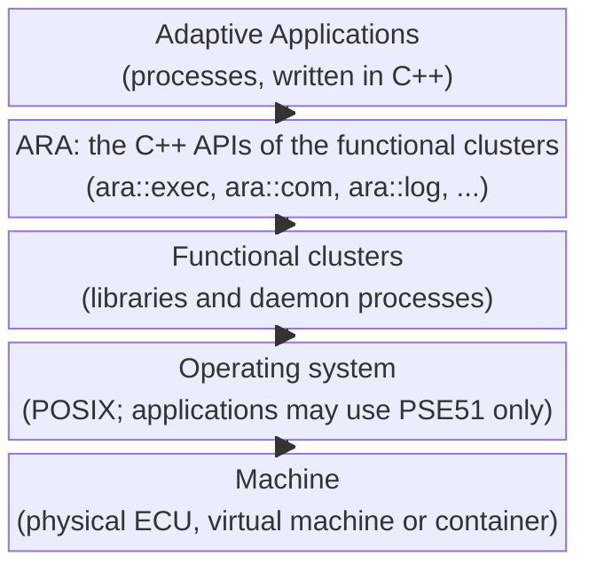
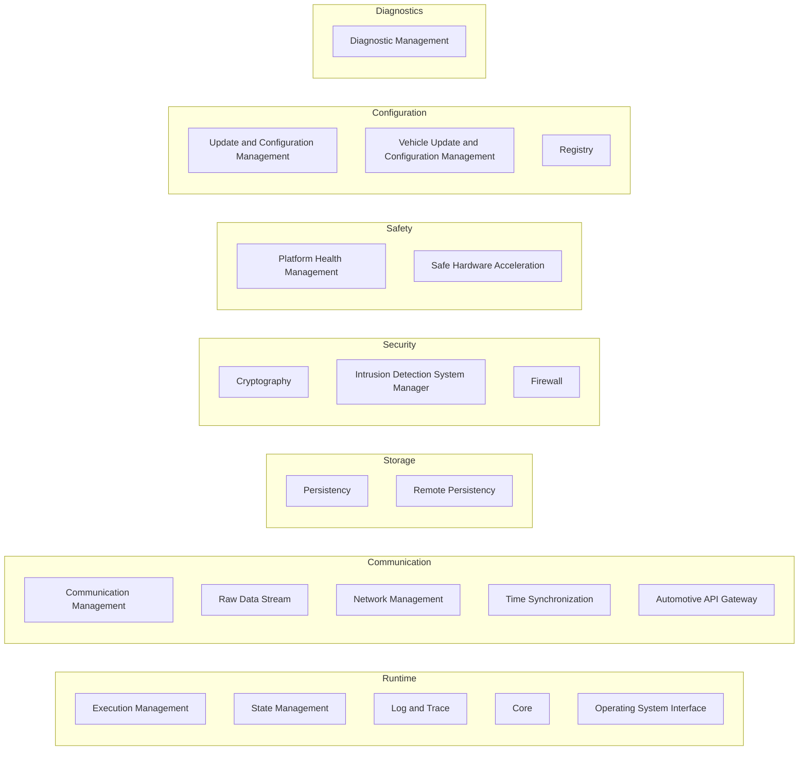

# AUTOSAR Adaptive Platform Training Guides

A series of training guides for engineers who are new to the AUTOSAR Adaptive Platform (AP). Each guide explains one functional cluster or topic, covering what it does, how it works, how to configure it and how to use its C++ API. The guides are based on the official AUTOSAR specifications (release **R25-11**) and on reputable public sources.

## Who These Guides Are For

- **Application developers** who write software that runs on the Adaptive Platform.
- **Integrators** who configure manifests, deploy software and debug ECUs.
- **Platform developers** who build or extend functional clusters.

Assumed background: modern C++, plus basic Linux/POSIX knowledge (processes, signals, sockets). No prior AUTOSAR knowledge is needed. AUTOSAR Classic experience helps but is optional. The following table shows which knowledge each guide needs.

| Area | What you should know | Where it is needed |
| --- | --- | --- |
| C++ | Classes, RAII, move semantics, templates, lambdas, smart pointers, `std::future`-style asynchronous results | All API chapters |
| Linux/POSIX | Processes, signals, threads, file systems, sockets | Platform Overview, EM, Persistency, IDSM and Firewall |
| Networking | Ethernet, IP, UDP, TCP, multicast | CM, [Network Bindings](guides/NetworkBindings.md), NM/TSync/RDS, IDSM and Firewall |
| CAN (optional) | Frames, signals, cyclic transmission | [Network Bindings](guides/NetworkBindings.md) (Signal-to-Service translation) |
| Diagnostics (optional) | The idea of UDS services, DIDs and DTCs | Diagnostics Part 1, Diagnostics Part 2 |

## The Adaptive Platform in One Page

**Why a second platform?** Classic ECUs control electrical outputs based on input signals, and their software rarely changes during the life of a vehicle. The AUTOSAR **Classic Platform (CP)** is designed for these deeply embedded ECUs. Functions such as automated driving are different: they need much more computing power, they connect the vehicle to backend systems, and their software must be updated during the life of the vehicle. AUTOSAR therefore specifies a second software platform, the **Adaptive Platform (AP)**. It provides high-performance computing and communication, and it allows flexible software configuration, for example for over-the-air updates (*Platform Design*, Section 3.1).

Two technology trends drive the Adaptive Platform: **Ethernet**, which offers much more bandwidth than CAN, and **processors** with many cores, GPUs and hardware accelerators (*Platform Design*, Section 3.2). The following table summarizes the characteristics that result (*Platform Design*, Section 3.3).

| Characteristic | What it means for you |
| --- | --- |
| C++ | Applications are written in C++. |
| Service-oriented architecture (SOA) | Applications offer and use *services*. The code is the same whether the service runs on the same machine or on another one. |
| Parallel processing | The platform is designed for multi-core processors. |
| Existing standards | AP reuses existing standards, for example POSIX for the operating system, instead of inventing new ones. |
| Safety and security | Architecture, dedicated functional clusters and guidelines support safe and secure systems. |
| Planned dynamics | Software can be deployed incrementally during development. For production, the integrator can restrict the dynamic behavior, for example to a pre-determined service discovery or to authenticated code only. |
| Agile | The platform can be updated after deployment, which supports incremental development. |

**How it is built, in five sentences** (*Platform Design*, Sections 4.1 and 4.2):

1. **Adaptive Applications** run on top of the **AUTOSAR Runtime for Adaptive Applications (ARA)**, which is the set of C++ interfaces that the **functional clusters** of the platform provide.
2. Applications may use only ARA and the minimal real-time POSIX profile **PSE51** of the operating system. This keeps them portable and isolated from each other.
3. **Execution Management** starts and stops the processes of the platform and of the applications. **State Management** decides which ones should run.
4. Applications talk to each other only through **Communication Management**, the platform's service-oriented middleware.
5. The platform runs on a **Machine**, which can be a physical ECU, a virtual machine or a container. One Machine runs exactly one instance of the platform.

The following diagram shows these layers. The [Platform Overview guide](guides/PlatformOverview.md#3-the-architecture-logical-view) explains them in detail.

The Adaptive Platform does not replace the Classic Platform. Both run side by side in the same vehicle and communicate, for example over SOME/IP, which both platforms support (*Platform Design*, Section 3.4). Signal-to-Service translation connects the signal-based Classic world to the service-oriented Adaptive world.

## What the Series Covers

The series covers the functional clusters that most AP projects use, one guide per cluster or topic. Each guide explains the concepts, the mechanisms, the configuration and the C++ API, and shows them on the running example.

The series does **not**:

- replace the specifications. Every normative statement points to a requirement ID, so that you can read the exact text. Where a guide and a specification differ, the specification applies.
- describe a particular vendor's product or tools. Where implementations differ, a **Note (implementation example)** box shows one typical approach.
- cover the Classic Platform, except where an Adaptive cluster interacts with it.

All guides use release R25-11 only. They never mix releases.

## The Guides

Start with [*The Running Example*](guides/RunningExample.md). It defines the invented ECU `HPC` that every guide uses. Keep the [*Series Glossary*](guides/Glossary.md) at hand: it defines every term and acronym of the series. Then read the guides in the order of this list. Each guide can also be read on its own: it briefly recaps what it needs from other guides and links to them.

| Guide | It answers the question | Status |
| --- | --- | --- |
| [The Running Example](guides/RunningExample.md) | What is the `HPC`, the invented ECU that all guides use? | Available (v1.0) |
| [Series Glossary](guides/Glossary.md) | What does a term or an acronym of the series mean? | Available (v1.0) |
| [Adaptive Platform Overview and Architecture](guides/PlatformOverview.md) | How is the platform structured, and what does the operating system provide? | In review |
| [Manifests and Methodology](guides/Manifests.md) | Who configures what, when, and in which manifest? | In review |
| [`ara::core` and General Conventions](guides/CoreAndGeneral.md) | How do the `ara::` APIs report errors, and how do I initialize the runtime? | In review |
| [Execution Management](guides/ExecutionManagement.md) | Who starts and stops my process, and how do state transitions work? | Available (v1.0) |
| [State Management](guides/StateManagement.md) | Who decides which Function Group States are active? | In review |
| [Platform Health Management](guides/PlatformHealthManagement.md) | How is my process supervised, and what happens when it misbehaves? | In review |
| [Communication Management Part 1: `ara::com` Concepts and API](guides/CommunicationManagement.md) | How do applications offer and use services in C++? | In review |
| [Communication Management Part 2: Network Bindings (SOME/IP, Signal-Based, DDS)](guides/NetworkBindings.md) | How do services travel over SOME/IP and DDS, and how do CAN signals become services? | In review |
| [Communication Management Part 3: Secure Communication and End-to-End Protection](guides/SecureAndSafeCommunication.md) | How is service communication protected against attackers and against faults? | In review |
| Network Management, Time Synchronization and Raw Data Stream | How are networks woken, clocks synchronized and raw sensor data streamed? | Planned |
| [Log and Trace](guides/LogAndTrace.md) | How do I log, and how do I read a DLT trace? | In review |
| [Persistency](guides/Persistency.md) | How do I keep data across power cycles and updates? | In review |
| [Diagnostics Part 1](guides/DiagnosticsPart1.md) | How does a diagnostic tester talk to the `HPC`? | In review |
| [Diagnostics Part 2](guides/DiagnosticsPart2.md) | How are faults detected, stored as DTCs and read out, and how does SOVD work? | In review |
| Update and Configuration Management | How is software installed, updated and rolled back? | Planned |
| Cryptography | How do I use keys, certificates and crypto primitives safely? | Planned |
| Identity and Access Management | Who may use which service or platform interface? | Planned |
| Intrusion Detection System Manager and Firewall | How are security events collected, and how is network traffic filtered? | Planned |
| End-to-End Integration: A Day in the Life of the HPC | How do all clusters work together over a whole day? | Planned |

The version in brackets is the current version of the guide. It increases when a revised guide is published. Guides without a link are planned.

Tables in the guides refer to other guides by short names: Running Example, Series Glossary, Platform Overview, Manifests, Core (`ara::core` and General Conventions), EM, SM, PHM, CM (Communication Management Part 1), Network Bindings (Part 2), Secure Communication (Part 3), NM/TSync/RDS, Log and Trace, Persistency, Diagnostics Part 1, Diagnostics Part 2, UCM, Cryptography, IAM, IDSM and Firewall, and Integration.

## The Running Example

All guides share one running example: an invented high-performance ECU called **HPC** that runs an ADAS feature. Every guide shows its topic on this example, so the pieces fit together as you read on. The [Running Example guide](guides/RunningExample.md) defines the example completely, and each of its elements names the guide that explains it in detail.

## How the Guides Are Built

Every guide about a functional cluster follows the same pattern, so that you always know where to look:

1. **About This Guide:** audience, learning objectives and the parts of the running example that the guide uses.
2. **Concept chapters:** what the cluster does and does not do, its vocabulary and its place in the architecture.
3. **Mechanism chapters:** how the cluster behaves, with rules, requirement IDs, diagrams and worked examples.
4. **API Reference:** the `ara::` C++ interface with usage examples.
5. **Configuration Overview:** where the configuration lives and how its elements relate.
6. **Configuration Reference:** the minimal configuration, every setting with its meaning, values, default and effect, and the complete configuration of the running example.
7. **Practice:** reporting, an end-to-end walkthrough, best practices, pitfalls and troubleshooting.
8. **Summary and Self-Check Quiz**, with answers.
9. **Appendices:** glossary, cheat sheet, traceability to the specification, notable changes between releases, and references.

The Running Example and the Series Glossary are references and do not follow this pattern. The Platform Overview, Manifests and Core guides cover cross-cutting topics and adapt it.

## Functional Clusters and Their Guides

A **functional cluster** is a logical group of platform functionality, such as Execution Management or Persistency. The *Software Architecture* explanation sorts the R25-11 clusters into seven categories (*SW Architecture*, Section 9.1):

The following table maps each cluster to its guide. The columns come from two explanatory documents:

- **Namespace** and **ARA group** follow the logical view of the platform (*Platform Design*, Figure 4.1). *Foundation* clusters provide the fundamental functions and are library-based: the application links a library that provides the API. *Platform Service* clusters are service-based: they offer their API as `ara::com` services (*Platform Design*, Section 4.2.2). *Vehicle Service* clusters provide vehicle-level functions.
- **Daemon-based** means that the cluster is intended to be implemented with its own daemon process. An implementation may deviate from this (*SW Architecture*, Table 9.1).

| Functional cluster | Namespace | Category | ARA group | Daemon-based | Guide |
| --- | --- | --- | --- | --- | --- |
| Execution Management | `ara::exec` | Runtime | Foundation | yes | [EM](guides/ExecutionManagement.md) |
| State Management | `ara::sm` | Runtime | Platform Service | yes | [SM](guides/StateManagement.md) |
| Log and Trace | `ara::log` | Runtime | Foundation | no | [Log and Trace](guides/LogAndTrace.md) |
| Core | `ara::core` | Runtime | Foundation | no | [Core](guides/CoreAndGeneral.md) |
| Operating System Interface | (POSIX PSE51, C++ standard library) | Runtime | Foundation | no | [Platform Overview](guides/PlatformOverview.md#7-the-operating-system-interface) |
| Communication Management | `ara::com` | Communication | Foundation | yes | [CM](guides/CommunicationManagement.md), [Network Bindings](guides/NetworkBindings.md) |
| Raw Data Stream | `ara::rds` | Communication | Foundation | no | NM/TSync/RDS |
| Network Management | `ara::nm` | Communication | Foundation | yes | NM/TSync/RDS |
| Time Synchronization | `ara::tsync` | Communication | Foundation | yes | NM/TSync/RDS |
| Automotive API Gateway | `ara::aag` | Communication | Vehicle Service | yes | not covered ([Topics Outside the Series](#topics-outside-the-series)) |
| Persistency | `ara::per` | Storage | Foundation | no | [Persistency](guides/Persistency.md) |
| Remote Persistency | `ara::rper` | Storage | Vehicle Service | yes | not covered |
| Cryptography | `ara::crypto` | Security | Foundation | yes | Cryptography |
| Intrusion Detection System Manager | `ara::idsm` | Security | Foundation | yes | IDSM and Firewall |
| Firewall | `ara::fw` | Security | Foundation | yes | IDSM and Firewall |
| Platform Health Management | `ara::phm` | Safety | Foundation | yes | [PHM](guides/PlatformHealthManagement.md) |
| Safe Hardware Acceleration | `ara::shwa` | Safety | Foundation | no | not covered |
| Update and Configuration Management | `ara::ucm` | Configuration | Platform Service | yes | UCM |
| Vehicle Update and Configuration Management | `ara::vucm` | Configuration | Vehicle Service | yes | UCM (context only) |
| Registry | (internal, no public API) | Configuration | (not shown) | no | not covered |
| Diagnostic Management | `ara::diag` | Diagnostics | Foundation | yes | [Diagnostics Part 1](guides/DiagnosticsPart1.md), [Diagnostics Part 2](guides/DiagnosticsPart2.md) |

The [Platform Overview guide, Chapter 5](guides/PlatformOverview.md#5-the-functional-clusters-of-r25-11) describes each cluster in one paragraph, including the clusters that this series does not cover.

**Identity and Access Management (IAM)** does not appear in the table because the *Software Architecture* explanation does not list it as a building block. It is a framework that several clusters implement, built from a Policy Decision Point and Policy Enforcement Points (*Platform Design*, Chapter 14). The IAM guide covers it.

## Topics Outside the Series

The following topics are part of R25-11 but have no guide of their own. The [Platform Overview guide, Chapter 5](guides/PlatformOverview.md#5-the-functional-clusters-of-r25-11) summarizes them so that you know they exist.

| Topic | What it is | Where to read more |
| --- | --- | --- |
| Automotive API Gateway | Gives off-board and on-board clients access to selected vehicle data through the Vehicle Information Service Specification (VISS) and the Vehicle Signal Specification (VSS). | *Platform Design*, Chapter 22 |
| Remote Persistency | Shares data stored by Persistency between applications through services, on the same or on different machines. | *Platform Design*, Chapter 23 |
| Safe Hardware Acceleration | An API to run tasks on hardware accelerators, such as GPUs, with safety in mind. | *Platform Design*, Section 17.4 |
| Registry | An internal component that gives other clusters access to manifest information. It is not used by applications. | *SW Architecture*, Section 9.7.3 |
| Sensor Interfaces | Standardized service interfaces for sensor data according to ISO 23150. They are interfaces, not a cluster. | *Platform Design*, Chapter 24 |
| Vehicle Update and Configuration Management | Coordinates software updates across all ECUs of a vehicle. The UCM guide explains only how it uses UCM. | *Platform Design*, Section 13.5 |
| Classic Platform | The AUTOSAR platform for deeply embedded ECUs. | The CP standard at <https://www.autosar.org/standards> |

## Conventions

All guides use the same conventions. Once you know them, you can tell at a glance whether a statement is mandated by AUTOSAR, explained by it, or only a typical implementation.

### Requirement and Constraint IDs

An ID in square brackets, such as `[SWS_EM_01050]`, points to a requirement or constraint in a specification. The guides cite IDs where they make a normative statement, at most a few in one place, and list the rest in the *Spec Traceability* appendix.

| Form | Example | Source |
| --- | --- | --- |
| `[SWS_<cluster>_<number>]` | `[SWS_EM_01050]` | Software Specification of a cluster |
| `[TPS_<template>_<number>]` | `[TPS_MANI_01041]` | Template Specification, for example the Manifest Specification |
| `[constr_<number>]` | `[constr_1688]` | Constraint on the meta-model |
| `[PRS_<protocol>_<number>]` | (in the Network Bindings, Secure Communication and Log and Trace guides) | Protocol Requirements Specification |
| `[RS_<cluster>_<number>]` | (rare) | Requirements Specification |

### Three Kinds of Statements

Every guide keeps three kinds of statements apart:

| Kind | How you recognize it | Example |
| --- | --- | --- |
| **Normative**: the specification requires it | A requirement ID, or "the specification requires" | "EM uses `Off` as the initial state of every Function Group [SWS_EM_01110]." |
| **Explanatory**: the specification explains it | A reference to an EXP or TR document or section | "AUTOSAR recommends a library-based design for clusters used only locally." |
| **Implementation example**: what implementations typically do | A **Note (implementation example)** box | "On Linux, EM can implement ResourceGroups with cgroups." |

If the specification is silent or ambiguous on a point, the guide says so explicitly instead of guessing.

### Boxes and Markers

| Marker | Meaning |
| --- | --- |
| `> **Why this matters:**` | The first lines of every chapter: why you should read it. |
| `> **Key takeaways**` | The last lines of every chapter: three to six points to remember. |
| **Pitfall** | A common mistake, with its cause. |
| **Note (implementation example)** | Not mandated by AUTOSAR; one typical way to do it. |
| *illustrative* | A value of the running example that was invented for teaching, such as an IP address or a service ID. |

### Code, Manifests and Diagrams

- **Code** follows the R25-11 API: names, signatures and headers as in the specification. Examples are short and illustrative. Vendor headers may differ in detail.
- **Manifests** are AUTOSAR XML (ARXML) files. To keep examples readable, guides often show a *conceptual* view that starts with the comment `# Conceptual view ... NOT real ARXML syntax.` Real ARXML appears only where it follows the R25-11 XML Schema and the Manifest Specification, mainly in the Manifests guide ([complete configuration of the running example](guides/Manifests.md#1216-the-running-example-complete-configuration)).
- **Diagrams** use Mermaid: sequence diagrams for interactions, state diagrams for states, flowcharts for structure and decisions, and block diagrams for layer stacks.

### Names and Typography

- **Terms of the specification** keep their exact spelling and capitalization, for example *Function Group State*, *Modelled Process* or *Service Instance Manifest*. The guides do not introduce synonyms.
- **Code font** marks meta-model names (`StateDependentStartupConfig`), API names (`ara::exec::ExecutionClient`), file names and the names of the running example (`Fusion`, `ADAS.Normal`).
- **Process.** "Process" alone means the running OS process; "Modelled Process" means its description in the manifest (see the [EM guide, Section 2.1](guides/ExecutionManagement.md#21-software-units-from-application-to-os-process)).
- **Running** has three meanings: the Execution State `kRunning`, the Process State *Running*, and possibly the name of a Function Group State. The running example therefore never uses "Running" as a state name (see the [EM guide, Section 2.3](guides/ExecutionManagement.md#23-states)).
- **Illustrative values**, such as IP addresses, service IDs or diagnostic IDs of the running example, are invented for teaching and marked as such.

### Links Between Guides

A guide does not repeat what another guide explains. It gives a two- or three-line recap and links to the section that owns the topic, for example "see the [EM guide, Chapter 8](guides/ExecutionManagement.md#8-function-group-state-transitions-step-by-step)". Terms link to the [series glossary](guides/Glossary.md).

## The AUTOSAR Specifications

The guides cite the specifications but do not contain them. You can download them free of charge from <https://www.autosar.org/standards>. Choose **Adaptive Platform** and **Foundation**, release **R25-11**. The files are provided for information; read the disclaimer and terms of use in each file. A few guides also cite documents of the Classic Platform R25-11, for example the Platform Overview guide and the Diagnostics the Diagnostics Part 1 and Diagnostics Part 2 guides.

### How AUTOSAR Documents Are Named

Every AUTOSAR document has a name of the form `AUTOSAR_<standard>_<type>_<name>`, for example `AUTOSAR_AP_SWS_ExecutionManagement`. The *standard* is `AP` (Adaptive Platform), `CP` (Classic Platform) or `FO` (Foundation, the artifacts common to both platforms). The *type* tells you what kind of document it is:

| Type | Name | What it contains | Normative? |
| --- | --- | --- | --- |
| SWS | Software Specification | The behavior and API of one functional cluster. The main source of every cluster guide. | Yes |
| TPS | Template Specification | The meta-model, for example the *Manifest Specification* with all configuration elements. | Yes |
| PRS | Protocol Requirements Specification | A protocol on the wire, for example SOME/IP or DLT. | Yes |
| RS | Requirements Specification | The requirements that a cluster must fulfill, which the SWS refines. | Yes |
| EXP | Explanation | Background and design rationale, for example *Explanation of Adaptive Platform Design*. | No |
| TR | Technical Report | Reports such as the *Glossary* or a release overview. | No |

The guides rely on SWS, TPS and PRS for every normative statement, and on EXP and TR for explanations.

## Viewing the Guides

The guides are plain Markdown with [Mermaid](https://mermaid.js.org/) diagrams. They render natively on GitHub and GitLab. In VS Code, install the *Markdown Preview Mermaid Support* extension.

## Disclaimer

These guides are training material, not a normative reference. Where a guide and an AUTOSAR specification differ, the specification applies.
