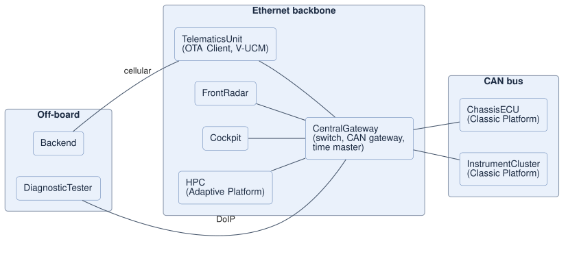
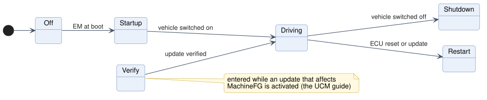
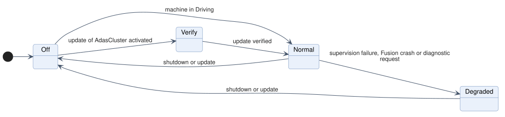
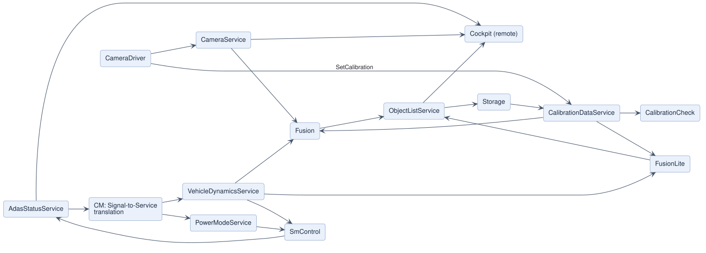
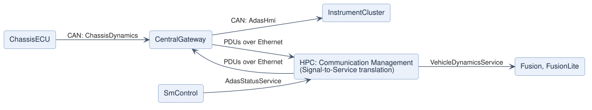

# AUTOSAR Adaptive Platform: The Running Example

<!-- markdownlint-disable MD013 MD033 -->

> **Source specification:**
>
> - *Explanation of Adaptive Platform Design* (`AUTOSAR_AP_EXP_PlatformDesign`), AUTOSAR Adaptive Platform **R25-11**.
> - *Explanation of Adaptive Platform Software Architecture* (`AUTOSAR_AP_EXP_SWArchitecture`), AUTOSAR Adaptive Platform **R25-11**.
>
> **Document type:** Training Material.
>
> **Author:** Hieu Do Minh
>
> **Version:** 1.0
>
> **Part of the series:** [AUTOSAR Adaptive Platform Training Guides](../README.md). Next: [Series Glossary](Glossary.md).

## About This Guide

All guides of the series show their topic on one invented system: the high-performance ECU `HPC`, which runs a camera- and radar-based ADAS feature. This guide is the master definition of that system. It describes the vehicle around `HPC`, the machine itself, its Function Groups, processes and services, its network deployment, its persistent data, diagnostics, updates, security and safety, and it names for each element the guide that explains it in detail. It does not explain a functional cluster. The [main page](../README.md) introduces the series, and the [Series Glossary](Glossary.md) defines the terms used here.

### Who This Guide Is For

Everyone who reads the series, in particular:

- **Application developers** who write software that runs on the Adaptive Platform.
- **Integrators** who configure manifests, deploy software and debug ECUs.
- **Platform developers** who build or extend functional clusters.

Assumed background: modern C++, plus basic Linux/POSIX knowledge. No prior AUTOSAR knowledge is needed.

### What You Will Get From This Guide

After reading this guide you will be able to:

1. Describe the `HPC` running example: its network, Function Groups, processes and services.
2. Find the guide that explains a given part of the example in detail.
3. Find the scenario on the running example that each guide tells.

### How to Read This Guide

Read [Section 1.1](#11-purpose-and-rules) to [Section 1.6](#16-services-and-their-consumers) once. The rest of [Chapter 1](#1-the-hpc-reference-system) is a reference: skim it now and come back when a guide uses a part of it. [Appendix A](#appendix-a-running-example-quick-reference) lists all names and values on one page.

| Convention | Meaning |
| --- | --- |
| *illustrative* | A value of the running example that was invented for teaching, such as an IP address or a service ID. |
| Owner guides | The guides that explain an element in detail, by short name. The [main page](../README.md#the-guides) lists all guides and their short names. |
| **Note** | Background or a simplification of the example. |
| **Pitfall** | A common mistake seen in real projects. |
| **Key takeaways** | A short summary at the end of the chapter. |
| Diagrams | Drawn in PlantUML and inserted as SVG images, so they show in any Markdown viewer. Click an image to open it at full size. |

## Table of Contents

- [AUTOSAR Adaptive Platform: The Running Example](#autosar-adaptive-platform-the-running-example)
  - [About This Guide](#about-this-guide)
    - [Who This Guide Is For](#who-this-guide-is-for)
    - [What You Will Get From This Guide](#what-you-will-get-from-this-guide)
    - [How to Read This Guide](#how-to-read-this-guide)
  - [Table of Contents](#table-of-contents)
  - [1. The HPC Reference System](#1-the-hpc-reference-system)
    - [1.1 Purpose and Rules](#11-purpose-and-rules)
    - [1.2 The Vehicle Context](#12-the-vehicle-context)
    - [1.3 The HPC Machine](#13-the-hpc-machine)
    - [1.4 Function Groups and States](#14-function-groups-and-states)
    - [1.5 Processes](#15-processes)
    - [1.6 Services and Their Consumers](#16-services-and-their-consumers)
    - [1.7 Network Deployment](#17-network-deployment)
    - [1.8 Classic ECUs and Signal-to-Service Translation](#18-classic-ecus-and-signal-to-service-translation)
    - [1.9 Persistent Data](#19-persistent-data)
    - [1.10 Diagnostics](#110-diagnostics)
    - [1.11 Software Updates](#111-software-updates)
    - [1.12 Security](#112-security)
    - [1.13 Safety](#113-safety)
    - [1.14 Time, Network Management and Logging](#114-time-network-management-and-logging)
    - [1.15 Scenario Index](#115-scenario-index)
  - [Appendix A. Running Example Quick Reference](#appendix-a-running-example-quick-reference)
    - [A.1 Nodes and Addresses](#a1-nodes-and-addresses)
    - [A.2 Function Groups and Processes](#a2-function-groups-and-processes)
    - [A.3 Services, Signals and Streams](#a3-services-signals-and-streams)
    - [A.4 Data, Diagnostics and Updates](#a4-data-diagnostics-and-updates)
    - [A.5 Security, Safety, Time and Logging](#a5-security-safety-time-and-logging)
  - [Appendix B. References](#appendix-b-references)

---

## 1. The HPC Reference System

> **Why this matters:** Abstract concepts are easier to learn on a concrete system. All guides use the same invented ECU, so that what you learn in one guide connects to the next. This chapter is the master definition of that system. It stays skeletal on purpose: each element names the guide that explains it in detail.

### 1.1 Purpose and Rules

`HPC` is a fictional high-performance ECU that runs a camera- and radar-based ADAS feature. It is small enough to keep in your head, but it touches every functional cluster of the series. It is not a real product. The Function Groups, the processes, their states and their Execution Dependencies were introduced by the [EM guide](ExecutionManagement.md#the-running-example).

Guide [Manifests](Manifests.md) writes a part of the example as real ARXML ([Section 12.16](Manifests.md#1216-the-running-example-complete-configuration)). All its model elements live in the top-level package `/HPC`, in sub-packages named after the recommended package of each element kind, for example `/HPC/ServiceInterfaces`, `/HPC/Executables` and `/HPC/Processes`. Standardized data types, such as `uint8_t`, are taken from the package `/AUTOSAR/StdTypes` that AUTOSAR publishes. The Manifests guide owns this package structure.

> **Note:** *HPC* is also the general AUTOSAR abbreviation for a *high performance computer*. In the series, `HPC` in code font always means the machine of the running example.

### 1.2 The Vehicle Context

The ADAS feature on `HPC` works like this. A front camera, attached to `HPC`, and the smart radar sensor `FrontRadar` observe the road. `HPC` combines their data with the vehicle speed, steering angle and yaw rate from the chassis, and computes a list of detected objects. The `Cockpit` computer shows the camera image and the objects to the driver, and the `InstrumentCluster` shows whether the ADAS feature is active. Software updates arrive over the air through the `TelematicsUnit`, and workshops connect a `DiagnosticTester`.

The following diagram shows the network topology.

| Node | Platform | Role in the example | IPv4 (illustrative) | Owner guides |
| --- | --- | --- | --- | --- |
| `HPC` | Adaptive Platform; the only node that is detailed | Runs the ADAS feature | `192.168.10.10` | all |
| `CentralGateway` | Classic Platform, black box | Ethernet switch; routes PDUs between the CAN bus and `HPC`; time master; sends `PowerMode`; access point for the `DiagnosticTester` | `192.168.10.1` | [Network Bindings](NetworkBindings.md), NM/TSync/RDS, Diagnostics Part 1 |
| `ChassisECU` | Classic Platform, CAN | Sends `VehicleSpeed`, `SteeringAngle` and `YawRate` | (CAN only) | [Network Bindings](NetworkBindings.md) |
| `InstrumentCluster` | Classic Platform, CAN | Shows `AdasStatus` to the driver | (CAN only) | [Network Bindings](NetworkBindings.md) |
| `FrontRadar` | Smart sensor, not AUTOSAR | Streams raw radar detections to `HPC` | `192.168.10.30` | NM/TSync/RDS |
| `Cockpit` | Black box; its platform is not specified | Shows the camera image, the detected objects and the ADAS status | `192.168.10.20` | [CM](CommunicationManagement.md#133-multi-binding), [Network Bindings](NetworkBindings.md), IDSM and Firewall |
| `TelematicsUnit` | Adaptive Platform, black box | Hosts the OTA Client and Vehicle Update and Configuration Management (V-UCM); connects the vehicle to the `Backend` | `192.168.10.40` | UCM |
| `DiagnosticTester` | Off-board | Sends UDS requests over DoIP | (assigned when connected) | Diagnostics Part 1, Diagnostics Part 2 |
| `Backend` | Off-board | Provides update packages; receives qualified security events | (off-board) | UCM, IDSM and Firewall |

> **Note (simplification):** A real ADAS ECU also controls actuators, such as brakes and steering, and uses more sensors. The example leaves them out. Its final output is the object list.

### 1.3 The HPC Machine

| Aspect | Value | Owner guides |
| --- | --- | --- |
| Machine | `HPC`: one Machine, running one instance of the Adaptive Platform | [Platform Overview](PlatformOverview.md#43-the-machine) |
| Hardware | A multi-core SoC (the processor `Soc` with the four cores `Core0` to `Core3`) with a Hardware Security Module (HSM), a hardware watchdog and flash memory for persistent data. No hypervisor. | [Platform Overview](PlatformOverview.md#92-the-hpc-machine-layer-by-layer), [Manifests](Manifests.md#76-worked-example-the-hpc-machine), PHM, Persistency, Cryptography |
| Machine design | `HpcDesign`: the design-time description of `HPC` in the system, with its Ethernet connection to the backbone | [Manifests](Manifests.md#72-machine-design), [Network Bindings](NetworkBindings.md) |
| Operating system | A POSIX operating system. Implementation notes in the series assume Linux. | [Platform Overview](PlatformOverview.md#7-the-operating-system-interface) |
| Network interface | One Ethernet interface on the backbone, `192.168.10.10/24` (illustrative) | [Network Bindings](NetworkBindings.md), IDSM and Firewall |
| Trusted Platform | `strictMode`: software that fails the integrity check is not started | [EM](ExecutionManagement.md#12-security-trusted-platform-and-iam) |
| ResourceGroups | `platform_rg` (20 % CPU, 512 MiB), `adas_rg` (60 % CPU, 2 GiB), `legacy_rg` (10 % CPU, 256 MiB) | [EM](ExecutionManagement.md#1311-the-running-example-complete-configuration) |
| Diagnostic address | DoIP logical address `0x1010` (illustrative) for the whole machine | Diagnostics Part 1 |
| Log ECU ID | `HPC1` (illustrative) | Log and Trace |

**Software Clusters.** A Software Cluster is the unit in which software is deployed and updated. Each Machine has exactly one Software Cluster with the category `PLATFORM_CORE`. It is expected to contain at least Execution Management, State Management and Update and Configuration Management, because these are needed to install any further software. A Function Group belongs to exactly one Software Cluster (*SW Architecture*, Sections 12.2 and 13.4). `HPC` has two Software Clusters:

| Software Cluster | Category | Version | Function Group | Contents | Owner guides |
| --- | --- | --- | --- | --- | --- |
| `HpcPlatformCore` | `PLATFORM_CORE` | 1.0.0 | `MachineFG` | The operating system, Execution Management, the processes `StateManager`, `SmControl`, `PlatformHealth` and `PowerControl`, the daemons of the other platform clusters, and the platform libraries | [Manifests](Manifests.md#104-worked-example-adascluster-and-hpcplatformcore), UCM |
| `AdasCluster` | `APPLICATION_LAYER` | 1.0.0, later 1.1.0 ([Section 1.11](#111-software-updates)) | `ADAS` | The seven ADAS processes and their configuration | [Manifests](Manifests.md#104-worked-example-adascluster-and-hpcplatformcore), UCM |

Each Software Cluster carries the ID of its vendor and is signed by that vendor: `HpcPlatformCore` has the vendor ID `0x1111` and is signed with `PlatformVendorCert`; `AdasCluster` has the vendor ID `0x1234` and is signed with `AdasSupplierCert` ([Section 1.12](#112-security)). The Manifests guide shows both Software Clusters as ARXML.

**Platform daemons.** Besides `StateManager` and `PlatformHealth`, `HpcPlatformCore` contains the daemons of Communication Management, Diagnostic Management, Update and Configuration Management, Cryptography, the Intrusion Detection System Manager, the Firewall, Network Management and Time Synchronization. EM starts them in `MachineFG.Startup`. Their process names are vendor-specific, so the series calls them by their cluster, for example "the UCM daemon". Library-based clusters, such as Log and Trace, Persistency, Core and Raw Data Stream, run inside the processes that use them.

### 1.4 Function Groups and States

`HPC` has two Function Groups, both defined in the [EM guide](ExecutionManagement.md#73-machinefg-and-machine-states):

- **`MachineFG`** controls the machine lifecycle. States: `Off`, `Startup`, `Driving`, `Shutdown`, `Restart` and `Verify`. `Driving` is project-specific; the others are mandatory.
- **`ADAS`** controls the ADAS feature. States: `Off`, `Normal`, `Degraded` and `Verify`. The *Manifest Specification* requires a `Verify` state in every Function Group ([constr_10023]). State Management switches `ADAS` to `Verify` while an update of `AdasCluster` is activated; the UCM guide decides which processes run in it.

The following diagrams show the main transitions. EM performs every transition; it initiates only `Off` → `Startup` of `MachineFG` itself. All other transitions are requested by State Management.

| Transition | Requested by State Management when ... | Owner guides |
| --- | --- | --- |
| `MachineFG`: `Off` → `Startup` | (not SM: EM performs it on its own at boot) | EM |
| `MachineFG`: `Startup` → `Driving` | startup is complete and `PowerMode` reports that the vehicle is switched on | SM |
| `ADAS`: `Off` → `Normal` | the machine is in `Driving`. SM also requests the partial network `AdasPn`. | [SM](StateManagement.md#76-worked-example-hpccontroller-and-adasagent), NM/TSync/RDS |
| `ADAS`: `Normal` → `Degraded` | PHM reports a supervision failure of `Fusion` or `CameraDriver`, EM reports that `Fusion` crashed (`ExecutionError` 42), or a diagnostic request asks for it through `SmControl` | EM, [SM](StateManagement.md#87-worked-example-fusion-fails-and-adas-goes-to-degraded), PHM, Diagnostics Part 1 |
| `ADAS`: `Degraded` → `Normal` | not during a drive. `ADAS` returns to `Normal` only when it is started again, at the next drive cycle through `Off`; this also restarts a failed `CameraDriver` | [SM](StateManagement.md#88-worked-example-a-stuck-cameradriver) |
| `ADAS` → `Off`, then `MachineFG` → `Shutdown` | `PowerMode` reports that the vehicle is switched off | EM, [SM](StateManagement.md#15-end-to-end-walkthrough-a-drive-cycle-of-the-hpc) |
| `MachineFG` → `Restart` | Diagnostic Management requests an ECU reset through `SmControl`, or UCM requests a machine reset | [SM](StateManagement.md#112-diagnostics-ecu-reset-and-communication-control), Diagnostics Part 1, UCM |
| `ADAS`: `Off` → `Verify` → `Normal` | UCM activates an update of `AdasCluster`: SM switches `ADAS` off, then to `Verify` to check the new software, and finally back to `Normal` (*Platform Design*, Figure 13.10) | [SM](StateManagement.md#97-worked-example-updating-adascluster-to-110), UCM |
| `MachineFG` → `Verify` | UCM activates an update that affects `MachineFG`, that is, the `HpcPlatformCore` Software Cluster | SM, UCM |

**State Management design.** `HPC` uses the *StateMachine approach* of State Management (the [SM guide, Section 1.4](StateManagement.md#14-two-ways-to-build-state-management)). The process `StateManager` runs two StateMachines; the project-specific application `SmControl` decides which transitions to request (the [SM guide, Section 7.6](StateManagement.md#76-worked-example-hpccontroller-and-adasagent)). All values are illustrative.

| StateMachine | Role | Controls | StateMachine States (initial in bold) | Transition requests (value) | Error reactions |
| --- | --- | --- | --- | --- | --- |
| `HpcController` | Controller | `MachineFG`; starts and stops `AdasAgent` | **`Init`**, `Driving`, `Shutdown`, `Restart`, `PrepareUpdate`, `VerifyUpdate`, `PrepareRollback`, `AfterUpdate`, `ContinueUpdate`, `LeaveSuspend` | `Drive` (1), `PowerOff` (2), `Reset` (3) | `ANY` → `Restart` |
| `AdasAgent` | Agent | `ADAS` and the partial network `AdasPn` (network handle `AdasPnHandle`) | `Off`, **`Normal`**, `Degraded`, `PrepareUpdate`, `VerifyUpdate`, `PrepareRollback` | `Degrade` (10), from `Normal` only | 42 → `Degraded`; 1 → `Degraded`; `ANY` → `Off` |

The `Off` state of `AdasAgent` keeps `AdasPn` for an afterrun of 2 s before it releases it. `HPC` does not use Suspend-to-RAM; `LeaveSuspend` exists only because R25-11 requires it in every Controller (the [SM guide, Section 10.8](StateManagement.md#108-what-hpc-does)). The [SM guide, Section 12.12](StateManagement.md#1212-the-running-example-complete-configuration) gives the complete configuration.

### 1.5 Processes

Ten processes come from the [EM guide](ExecutionManagement.md#the-running-example); the SM guide added the eleventh, `SmControl`. The executables marked with \* are named here for the first time. The role column adds what the other guides need.

| Process | Executable | Function Group States | ResourceGroup | Role | Owner guides |
| --- | --- | --- | --- | --- | --- |
| `StateManager` | `state_manager`\* | `MachineFG`: Startup, Driving, Shutdown, Restart, Verify | `platform_rg` | The State Management daemon. Runs the StateMachines `HpcController` and `AdasAgent` and provides their services, the `UpdateAllowedService` and the `UpdateRequest` service for UCM. | EM, [SM](StateManagement.md#31-where-state-management-sits-in-the-platform) |
| `SmControl` | `sm_control`\* | `MachineFG`: Startup, Driving, Verify | `platform_rg` | The SMControlApplication with the project-specific logic: uses `PowerModeService` and `VehicleDynamicsService`, provides `AdasStatusService`, requests StateMachine transitions, decides whether an update is allowed, and implements the ECU reset for Diagnostic Management. | [SM](StateManagement.md#26-smcontrolapplication), [Network Bindings](NetworkBindings.md), Diagnostics Part 1 |
| `PlatformHealth` | `platform_health`\* | same as `StateManager` | `platform_rg` | The Platform Health Management daemon. Supervises `Fusion` and `CameraDriver` and triggers the watchdog. | EM, PHM |
| `PowerControl` | `power_control`\* | `MachineFG`: Shutdown, Restart | `platform_rg` | Powers off or reboots the machine. | EM, SM |
| `Storage` | `storage` | `ADAS`: Normal, Degraded | `adas_rg` | The ADAS data store. Keeps the camera calibration, provides `CalibrationDataService`, and records object lists. | EM, [CM](CommunicationManagement.md#1513-complete-example-storage), Persistency |
| `CameraDriver` | `camera_driver`\* | `ADAS`: Normal, Degraded | `adas_rg` | Drives the front camera. Provides `CameraService`, time-stamps images, detects a blocked camera and runs the camera calibration routine. | [CM](CommunicationManagement.md#1511-complete-example-cameradriver), NM/TSync/RDS, Diagnostics Part 1, Diagnostics Part 2 |
| `CalibrationCheck` | `calib_check` | `ADAS`: Normal | `adas_rg` | Self-terminating check at ADAS start: reads the calibration through `CalibrationDataService` and verifies that it is complete, plausible and authentic. | EM, Persistency, Cryptography |
| `LegacyLogger` | `legacy_logger` | `ADAS`: Normal, Degraded | `legacy_rg` | Third-party data logger. Non-reporting; cannot be modified. | EM |
| `LoggerCompanion` | `logger_companion` | `ADAS`: Normal, Degraded | `adas_rg` | Companion process of `LegacyLogger`. | EM |
| `Fusion` | `fusion` (version 1.0.0, later 1.1.0) | `ADAS`: Normal | `adas_rg` | Fuses camera images, radar detections and vehicle dynamics into an object list. Provides `ObjectListService` and a DID. Supervised by PHM. `processExecutionError` = 42, which is the application error `FusionFailed` of the error domain `AdasExecutionErrors`. | [Manifests](Manifests.md#84-worked-example-the-processes-cameradriver-and-fusion), [Core](CoreAndGeneral.md#16-end-to-end-walkthrough-a-day-of-error-handling-in-fusion), EM, PHM, [CM](CommunicationManagement.md#1512-complete-example-fusion), Log and Trace, Persistency, Diagnostics Part 1, UCM |
| `FusionLite` | `fusion_lite`\* | `ADAS`: Degraded | `adas_rg` | Reduced fallback that uses only the radar and vehicle dynamics, so it also works with a blocked camera. Provides a reduced `ObjectListService`. | EM, PHM, IAM |

The Execution Dependencies are unchanged from the [EM guide](ExecutionManagement.md#65-dependencies-in-the-running-example): `CalibrationCheck` needs `Storage` *Running*; `LoggerCompanion` needs `LegacyLogger` *Running*; `Fusion` needs `CalibrationCheck` *Terminated* and `LoggerCompanion` *Running*; `FusionLite` needs `LoggerCompanion` *Running*.

**Software components and instance specifiers.** The Manifests guide ([Section 5.5](Manifests.md#55-worked-example-cameradriver-and-fusion)) models the executables `camera_driver` and `fusion` with one software component each, `CameraDriverSwc` and `FusionSwc`, placed in the root prototype `Root` of the executable. Their ports for `CameraService` are `CameraPPort` (provided) and `CameraRPort` (required). The application code therefore identifies them with the instance specifiers `/camera_driver/Root/CameraPPort` and `/fusion/Root/CameraRPort`. For Platform Health Management, `FusionSwc` also has the R-port `FusionCyclePort` and `CameraDriverSwc` the R-port `ImageLoopPort`, typed by the Supervised Entity interfaces `FusionCycle` and `CameraImageLoop` ([Section 1.13](#113-safety)); their instance specifiers are `/fusion/Root/FusionCyclePort` and `/camera_driver/Root/ImageLoopPort`. Other executables are modeled in the same way when a guide needs them. The CM guide adds the ports of `ObjectListService` and `CalibrationDataService`: `FusionSwc` has the P-port `ObjectListPPort` and the R-port `CalibrationRPort`, and `CameraDriverSwc` the R-port `CalibrationRPort`. The executables `fusion_lite`, `storage` and `calib_check` hold the components `FusionLiteSwc` (`ObjectListPPort`, `CalibrationRPort`), `StorageSwc` (`CalibrationPPort`, `ObjectListRPort`) and `CalibrationCheckSwc` (`CalibrationRPort`) in their root prototypes `Root`, so that the code uses specifiers such as `/fusion/Root/ObjectListPPort`, `/storage/Root/CalibrationPPort` and `/calib_check/Root/CalibrationRPort`. The `FieldSenderComSpec` of `ObjectListPPort` gives the field `FusionMode` the initial value `Full` in `FusionSwc` and `RadarOnly` in `FusionLiteSwc` (the [CM guide, Section 14.11](CommunicationManagement.md#1411-the-running-example-complete-configuration)).

**State Management ports and process states.** The executable `state_manager` has, in its root prototype `Root`, the R-ports `MachineFgPort` and `AdasFgPort`, typed by the State Client interfaces `MachineFgStateClient` and `AdasStateClient`, so that the code uses the instance specifiers `/state_manager/Root/MachineFgPort` and `/state_manager/Root/AdasFgPort`. The Function Group Port Mappings `StateManagerToMachineFG` and `StateManagerToADAS` connect the two ports of the process `StateManager` to `MachineFG` and `ADAS` ([EM guide, Section 13.10](ExecutionManagement.md#1310-state-management-access-stateclientinterface-and-functiongroupportmapping)). The root prototype is typed by the component `StateManagerSwc`. For Platform Health Management, it also has the P-port `PhmRecoveryPort`, typed by the recovery notification interface `SupervisionRecovery`, and the R-port `HeartbeatPort`, typed by the Supervised Entity interface `StateManagerHeartbeat` ([Section 1.13](#113-safety)); the instance specifiers are `/state_manager/Root/PhmRecoveryPort` and `/state_manager/Root/HeartbeatPort`. For its StateMachines, `StateManagerSwc` has P-ports for the services of each StateMachine (`ControllerServicePort`, `AdasServicePort`, `ControllerStatePort`, `AdasStatePort`), for `UpdateAllowedService` (`UpdateAllowedPort`) and for `UpdateRequest` (`UpdateRequestPort`), and R-ports as inputs of its tables (`ControllerTriggerPort`, `AdasTriggerPort`, `ControllerErrorPort`, `AdasErrorPort`). `SmControl` is modeled by the component `SmControlSwc` in the root prototype `Root` of `sm_control`, with the ports `PowerModeRPort`, `VehicleDynamicsRPort`, `AdasStatusPPort`, `ControllerRequestRPort`, `AdasRequestRPort`, `AdasStateRPort`, `UpdateAllowedRPort` and `EcuResetPort` (the [SM guide, Section 12.9](StateManagement.md#129-port-interfaces-and-ports)). The processes that others depend on (`Storage`, `CalibrationCheck`, `LegacyLogger`, `LoggerCompanion`) have a process state machine typed by the group `ProcessStates`, with the states `Running` and `Terminated` ([EM guide, Section 13.11](ExecutionManagement.md#1311-the-running-example-complete-configuration)).

> **Pitfall:** Service use is not an Execution Dependency. `Fusion` uses `CameraService`, but it has no Execution Dependency on `CameraDriver`. It waits for the service through Service Discovery, as the EM guide recommends ([EM guide, Section 6.6](ExecutionManagement.md#66-prefer-service-discovery-for-applications)).

### 1.6 Services and Their Consumers

| Service interface | Provider | Consumers | Elements | Owner guides |
| --- | --- | --- | --- | --- |
| `CameraService` | `CameraDriver` | `Fusion` (on `HPC`), `Cockpit` (remote) | event `Image`, method `SetExposureMode`, field `CameraStatus` | [Manifests](Manifests.md#66-worked-example-cameraservice-as-arxml), [CM](CommunicationManagement.md#56-worked-example-the-generated-api-of-cameraservice), [Network Bindings](NetworkBindings.md) |
| `ObjectListService` | `Fusion`; `FusionLite` with reduced content | `Storage` (on `HPC`), `Cockpit` (remote) | event `ObjectList`, field `FusionMode` | [CM](CommunicationManagement.md#78-worked-example-images-for-fusion-object-lists-for-storage), [Network Bindings](NetworkBindings.md) |
| `CalibrationDataService` | `Storage` | read: `CalibrationCheck`, `Fusion`, `FusionLite`; write: `CameraDriver` | methods `GetCalibration`, `SetCalibration`, trigger `CalibrationUpdated` | [CM](CommunicationManagement.md#135-worked-example-calibrationdataservice-over-local-ipc), Persistency, IAM |
| `VehicleDynamicsService` | Communication Management, by Signal-to-Service translation | `Fusion`, `FusionLite`, `SmControl` | events `VehicleSpeed`, `SteeringAngle`, `YawRate` | [Network Bindings](NetworkBindings.md) |
| `PowerModeService` | Communication Management, by Signal-to-Service translation | `SmControl` | field `PowerMode` (notifier only) with the values `Off` and `On` | [SM](StateManagement.md#55-worked-example-smcontrol-brings-hpc-from-startup-to-driving), [Network Bindings](NetworkBindings.md) |
| `AdasStatusService` | `SmControl` | `InstrumentCluster` (through Signal-to-Service translation), `Cockpit` | field `AdasStatus` (notifier only) with the values `Off`, `Active`, `Degraded`, `Unavailable` | [SM](StateManagement.md#137-example-the-main-loop-of-smcontrol), [Network Bindings](NetworkBindings.md) |

**The `CameraService` contract** (detailed in the [Manifests guide, Section 6.6](Manifests.md#66-worked-example-cameraservice-as-arxml)). Namespace `hpc::camera`, version 1.0. The event `Image` carries a `CameraImage`: `timestamp` (`uint64_t`), `width` and `height` (`uint16_t`) and `pixels` (a vector of `uint8_t`). The field `CameraStatus` has the type `CameraState` with the values `Ok`, `Blocked` and `NotAvailable`; it has a getter and a notifier but no setter, and its initial value is `NotAvailable`. The method `SetExposureMode(mode)` takes an `ExposureMode` with the values `Auto`, `Day` and `Night`, and can fail with the application error `ExposureModeNotSupported` (code 1 of the error domain `CameraErrors`). `Fusion` calls `SetExposureMode(Night)` when the camera image gets dark; if `CameraDriver` answers `ExposureModeNotSupported`, `Fusion` keeps the mode `Auto` (the [Core guide, Section 9.7](CoreAndGeneral.md#97-worked-example-fusion-requests-the-night-exposure-mode)).

**The `ObjectListService` contract** (detailed in the [CM guide, Section 14.11](CommunicationManagement.md#1411-the-running-example-complete-configuration)). Namespace `hpc::fusion`, version 1.0. The event `ObjectList` carries an `ObjectListData`: `timestamp` (`uint64_t`, `VehicleTime`) and `objects`, a vector of `DetectedObject` with `id` (`uint16_t`), `kind` (`ObjectKind` with the values `Unknown`, `Vehicle`, `Pedestrian` and `Cyclist`), `x` and `y` (`float`, in metres) and `vx` and `vy` (`float`, in metres per second). The field `FusionMode` has the type `FusionModeType` with the values `Full` and `RadarOnly`; it has a getter and a notifier but no setter. `Fusion` publishes `Full`, `FusionLite` publishes `RadarOnly`.

**The `CalibrationDataService` contract** (detailed in the [CM guide, Section 13.5](CommunicationManagement.md#135-worked-example-calibrationdataservice-over-local-ipc)). Namespace `hpc::storage`, version 1.0. The method `GetCalibration(key)` returns the `CalibrationRecord` of a `CalibrationKey` (`CameraExtrinsics` or `RadarAlignment`, the keys of `CalibrationKvs`) or fails with `CalibrationNotFound`; `SetCalibration(key, record)` stores a record or fails with `CalibrationRejected`. A `CalibrationRecord` has `values` (a vector of `float`) and `writtenAt` (`uint64_t`). After each successful `SetCalibration`, `Storage` sends the trigger `CalibrationUpdated`, and `Fusion` and `FusionLite` read the calibration again. The skeletons of `CameraDriver` and `Storage` execute method calls with the processing mode `kEventSingleThread`.

**Error domains.** Every error belongs to an error domain, and the identifier of each domain must be unique in the platform. Application domains use identifiers whose most significant bit is 0 (the [Core guide, Section 7.4](CoreAndGeneral.md#74-error-domain-identifiers)). The example has four domains:

| Error domain | Identifier | Namespace | Errors (code) | How it is defined | Owner guides |
| --- | --- | --- | --- | --- | --- |
| `CameraErrors` | `0x1001` (4097) | `hpc::camera` | `ExposureModeNotSupported` (1) | Modeled; referenced by `SetExposureMode`, so its C++ code is generated | [Manifests](Manifests.md#63-application-errors), [Core](CoreAndGeneral.md#78-generated-error-domains), CM |
| `AdasExecutionErrors` | `0x1002` (4098) | none | `FusionFailed` (42), `AdasStateTimeout` (60), `AdasTransitionRequestFailed` (61) | Modeled; 42 is the `processExecutionError` of `Fusion`; 60 and 61 are error codes of the State Management configuration | [Manifests](Manifests.md#63-application-errors), EM, [SM](StateManagement.md#81-where-errors-come-from) |
| `FusionErrors` | `0x1003` (4099) | `hpc::fusion` | `kInputTimeout` (1), `kCalibrationImplausible` (2) | Written by hand inside `Fusion`, not modeled; used only inside the process | [Core](CoreAndGeneral.md#77-defining-a-new-error-domain) |
| `CalibrationErrors` | `0x1004` (4100) | `hpc::storage` | `CalibrationNotFound` (1), `CalibrationRejected` (2) | Modeled; referenced by `GetCalibration` and `SetCalibration` of `CalibrationDataService` | [CM](CommunicationManagement.md#88-application-errors), Persistency |

Three design decisions are worth knowing:

- **Shared data goes through a service.** Persistent data is private to one process (*Platform Design*, Section 10.1). `CalibrationCheck` and `Fusion` therefore cannot read data that another process stored. `Storage` owns the calibration and shares it through `CalibrationDataService`.
- **Two providers, never at the same time.** `Fusion` and `FusionLite` both provide `ObjectListService`, but they run in different `ADAS` states. They offer the same service instance, so the proxy of `Storage` simply reconnects after a switch (the [CM guide, Section 9.6](CommunicationManagement.md#96-worked-example-camerastatus-and-fusionmode)); the Network Bindings guide shows the DDS deployment.
- **The ADAS status comes from `SmControl`**, which follows the `CurrentState` of the StateMachine `AdasAgent` in State Management.

Standardized platform services, such as the `PackageManagement` service of UCM or the services of State Management (`StateMachineService` and `StateMachineNotification` for each StateMachine, `UpdateAllowedService` and `UpdateRequest`), are used as the specifications define them. The running example does not redefine them.

The following diagram shows who provides and who uses which service.

### 1.7 Network Deployment

All values in this section are illustrative. The owner guides check them against the protocol specifications.

| Communication | Binding or protocol | Details (illustrative) | Owner guides |
| --- | --- | --- | --- |
| `CameraService` | SOME/IP over TCP, secured with TLS 1.2 (`CameraTlsServer` on `HPC`, `CameraTlsClient` for `Fusion`; cipher suite `TLS_ECDHE_ECDSA_WITH_AES_128_GCM_SHA256`); `SetExposureMode` E2E-protected with `PROFILE_04m` (data ID `0x10010001`, source ID of `Fusion` `0x0000001`) | Service ID `0x1001`, instance ID `0x0001`, TCP server port 30501 on `HPC`; method `SetExposureMode` `0x0001`, getter of `CameraStatus` `0x0002`, event `Image` `0x8001` and notifier of `CameraStatus` `0x8002` on the wire (event IDs 1 and 2 in the manifest; on the wire, an event carries its event ID plus `0x8000`), event group `CameraEvents` 1 | [Manifests](Manifests.md#96-worked-example-cameraservice-between-cameradriver-and-fusion), [Network Bindings](NetworkBindings.md), [Secure Communication](SecureAndSafeCommunication.md), Cryptography |
| `AdasStatusService` to `Cockpit` | SOME/IP over UDP, E2E-protected with `PROFILE_04` | Service ID `0x1002`, instance ID `0x0001`, UDP server port 30502 on `HPC`; notifier of `AdasStatus` event ID 1 (`0x8001` on the wire), event group `AdasStatusEvents` 1; E2E data ID `0x10020001`; `SmControl` publishes on every change and at least every 100 ms | Network Bindings, [Secure Communication](SecureAndSafeCommunication.md#116-worked-example-the-state-of-adasstatus-through-a-burst-of-lost-messages) |
| Service discovery for SOME/IP | SOME/IP-SD | UDP port 30490, multicast address `239.192.255.251` | Network Bindings |
| `ObjectListService` | DDS | Domain ID 1; topics `AdasObjectList` (event `ObjectList`) and `AdasFusionMode` (notifier of `FusionMode`); discovery type `TOPIC`; QoS profile `AdasReliable` (its content is vendor-specific; it should define a finite liveliness lease and a deadline); no E2E profile, because the DDS binding does not use the AUTOSAR E2E protocol | Network Bindings, [Secure Communication](SecureAndSafeCommunication.md#133-worked-example-what-storage-sees-for-objectlist) |
| `CalibrationDataService` | Local IPC binding | User-defined deployment `CalibrationDataService_Ipc` (category `SERVICE_INTERFACE_DEPLOYMENT_IPC`) on the connector `HpcIpcConnector` of `HpcDesign`; Minimum Send Interval of `SetCalibration` 1 s; only on `HPC` | [CM](CommunicationManagement.md#135-worked-example-calibrationdataservice-over-local-ipc) |
| `VehicleDynamicsService`, `PowerModeService`, `AdasStatusService` to `InstrumentCluster` | Signal-Based SOME/IP binding with the Partial SOME/IP Header (Signal-to-Service translation) | See [Section 1.8](#18-classic-ecus-and-signal-to-service-translation) | Network Bindings |
| Radar detections | Raw Data Stream over TCP | `FrontRadar` is the server at `192.168.10.30`, port 50001; `Fusion` or `FusionLite` connects as the client | NM/TSync/RDS |
| Software updates | `PackageManagement` service of UCM, used by V-UCM on `TelematicsUnit` | Service deployment defined in the UCM guide | UCM |
| Diagnostics | UDS over DoIP | DoIP port 13400; `HPC` logical address `0x1010`, tester logical address `0x0E80` | Diagnostics Part 1 |
| Network Management | UDP NM on the backbone | See [Section 1.14](#114-time-network-management-and-logging) | NM/TSync/RDS |
| Time synchronization | gPTP (IEEE 802.1AS) on the backbone | `CentralGateway` is the time master | NM/TSync/RDS |
| Logging | DLT protocol version 2 to a logging client on the network | ECU ID `HPC1`; DLT sink `HpcDltChannel`, log channel `HPCN`, TCP server port 3490 on `HPC` (`BackboneConnector`); non-verbose mode | [Log and Trace](LogAndTrace.md#102-machine-sinks-and-per-port-sinks) |

### 1.8 Classic ECUs and Signal-to-Service Translation

The Classic ECUs on the CAN bus exchange *signals*, not services. Signal-to-Service translation in Communication Management maps these signals to service elements on `HPC`, and back. The following diagram shows the path of the vehicle dynamics signals and of the ADAS status.

| Signals | Sender → receiver | PDU (CAN ID, cycle; illustrative) | Service on `HPC` |
| --- | --- | --- | --- |
| `VehicleSpeed`, `SteeringAngle`, `YawRate` | `ChassisECU` → `HPC` | `ChassisDynamics` (`0x101`, 10 ms) | `VehicleDynamicsService` |
| `PowerMode` | `CentralGateway` → `HPC` | `VehicleMode` (`0x120`, 100 ms) | `PowerModeService` |
| `AdasStatus` | `HPC` → `InstrumentCluster` | `AdasHmi` (`0x2A0`, 100 ms) | `AdasStatusService` |

The Adaptive Platform communicates over Ethernet at the data link layer (*Platform Design*, Section 8.1). `HPC` therefore has no CAN interface of its own: `CentralGateway` routes the PDUs between the CAN bus and `HPC`. The Network Bindings guide explains how Communication Management receives these PDUs and maps them to services.

The signals have this layout (illustrative; all signals little endian, as is common on CAN):

| PDU | Signal | Start bit, length | Type and scaling |
| --- | --- | --- | --- |
| `ChassisDynamics` (8 bytes) | `VehicleSpeed` | 0, 16 bit | unsigned, 0.01 km/h per bit |
| | `SteeringAngle` | 16, 16 bit | signed, 0.1 degree per bit |
| | `YawRate` | 32, 16 bit | signed, 0.01 degree/s per bit |
| | `ChassisDynamicsCrc` | 48, 8 bit | E2E CRC (`PROFILE_11`) |
| | `ChassisDynamicsCounter` | 56, 4 bit | E2E counter |
| | `ChassisDynamicsDataIdNibble` | 60, 4 bit | High nibble of the E2E data ID `0x101` |
| `VehicleMode` (1 byte) | `PowerMode` | 0, 2 bit | 0 = `Off`, 1 = `On` |
| `AdasHmi` (1 byte) | `AdasStatus` | 0, 3 bit | 0 = `Off`, 1 = `Active`, 2 = `Degraded`, 3 = `Unavailable` |

**Protection** (the [Secure Communication guide](SecureAndSafeCommunication.md)). `VehicleSpeed`, `SteeringAngle`, `YawRate` and the three E2E header signals form the signal group `ChassisDynamicsGroup`, protected end-to-end by `ChassisECU` with `PROFILE_11` (data ID `0x101`, `lower12Bit`); the translation on `HPC` is a safe translation. `CentralGateway` sends `VehicleMode` as the secured PDU `VehicleModeSecured` (5 bytes: the 1-byte PDU, an 8-bit truncated freshness value and a 24-bit truncated MAC; SecOC Profile 1, SecOC data ID `0x0120`, freshness value ID 1, key `VehicleModeSecOcKey`); the translation of `PowerMode` is a secure translation. `AdasHmi` is not protected.

On the Ethernet side, the PDUs use the **Signal-Based SOME/IP** binding with the **Partial SOME/IP Header**: each PDU is preceded by a 4-byte Message ID (service ID and event ID plus `0x8000`) and a 4-byte length. `CentralGateway` offers the translated services with SOME/IP service discovery and subscribes to the one that `HPC` provides.

| Service on `HPC` | Deployment for the translation (illustrative) | Consumers or receiver |
| --- | --- | --- |
| `VehicleDynamicsService` | Service ID `0x2001`, instance ID `0x0001`; the three events come from one PDU and therefore share event ID 1 (`0x8001` on the wire); event group `VehicleDynamicsEvents` 1; offered by `CentralGateway` (`192.168.10.1`, UDP port 30610); `HPC` receives on UDP port 30601 | `Fusion`, `FusionLite` and `SmControl`, each with its own required service instance |
| `PowerModeService` | Service ID `0x2002`, instance ID `0x0001`; notifier of `PowerMode` event ID 1; event group `PowerModeEvents` 1; offered by `CentralGateway` on UDP port 30610 | `SmControl` |
| `AdasStatusService` to `InstrumentCluster` | A second, signal-based deployment of the same service interface: service ID `0x2003`, instance ID `0x0001`; notifier of `AdasStatus` event ID 1; event group `AdasHmiEvents` 1; offered by `HPC` on UDP port 30602; `CentralGateway` subscribes and puts the PDU `AdasHmi` on CAN; `SmControl` publishes `AdasStatus` at least every 100 ms | `InstrumentCluster` |

### 1.9 Persistent Data

| Storage | Kind | Owner process | Content | Notes | Owner guides |
| --- | --- | --- | --- | --- | --- |
| `CalibrationKvs` | Key-Value Storage | `Storage` | Key `CameraExtrinsics` (mounting angles and position of the camera) and key `RadarAlignment` (angular offset of the radar) | Protected by a message authentication code (MAC) with `CalibrationMacKey`. Changed only through `SetCalibration`. | Persistency, Cryptography |
| `Recordings` | File Storage | `Storage` | Recorded object lists, one file per recording | Limited by a quota; the oldest recording is deleted first | Persistency |
| `FusionParams` | Key-Value Storage | `Fusion` | Key `TrackerTuning`: tuning parameters that `Fusion` learns while driving | Migrated by the update to `AdasCluster` 1.1.0, which changes the data type of `TrackerTuning` | Persistency, UCM |

**Ports and interfaces.** Each storage is reached through an R-port of the software component of its process: `CalibrationKvsPort` and `RecordingsPort` in `StorageSwc` (instance specifiers `/storage/Root/CalibrationKvsPort` and `/storage/Root/RecordingsPort`), and `FusionParamsPort` in `FusionSwc` (`/fusion/Root/FusionParamsPort`). The ports are typed by the persistency interfaces `CalibrationKvsInterface`, `RecordingsInterface` and `FusionParamsInterface`, all with the access mode `readWrite`. The values of `CalibrationKvs` have the type `CalibrationRecord` of `CalibrationDataService`; their initial values `CameraExtrinsicsDefault` and `RadarAlignmentDefault` mean "not calibrated" (an empty value list).

**`TrackerTuning` in two versions.** `fusion` 1.0.0 stores `hpc::fusion::TrackerTuningV1` (`gateDistance` as `float` in metres, `maxCoastCycles` as `std::uint8_t`). `fusion` 1.1.0 uses `hpc::fusion::TrackerTuningV2` (`gateDistance`, `maxCoastCycles` as `std::uint16_t`, and the new `minConfidence` as `float`), raises the contract version of `FusionParamsInterface` from 1.0.0 to 1.1.0, and declares the old type as the previous data type. When `Fusion` 1.1.0 opens `FusionParams` for the first time after the update, its update callback reports the old contract version; `Fusion` then converts the stored value and removes the backup (the [Persistency guide, Section 12.12](Persistency.md#1212-worked-example-fusionparams-and-the-update-to-adascluster-110)).

**Target configuration** (illustrative values; the [Persistency guide, Section 14.13](Persistency.md#1413-the-running-example-complete-configuration) has the details):

| Storage | Version | Update strategy | Minimum / maximum size | Integrity and security |
| --- | --- | --- | --- | --- |
| `CalibrationKvs` | 1.0.0 | keep existing | 16 KiB / 64 KiB | 2 out of 3 copies for the whole storage, in two locations; MAC `MAC/CMAC/AES-128` with the key slot `CalibrationMacKeySlot`, which holds `CalibrationMacKey` |
| `Recordings` | 1.0.0 | keep existing | 64 MiB / 256 MiB, at most 64 files | none: recordings can be made again |
| `FusionParams` | 1.0.0, 1.1.0 in `AdasCluster` 1.1.0 | keep existing | 4 KiB / 16 KiB | CRC `CRC_32P4` (32 bits) per key-value pair |

`Storage` syncs `CalibrationKvs` after every accepted `SetCalibration` and answers `CalibrationNotFound` when a key cannot be read or authenticated. It syncs a recording every 10 s and when the recording ends, and it deletes the oldest recording when the quota or the file limit is reached.

### 1.10 Diagnostics

| Element | Value (illustrative) | Provider on `HPC` | Owner guides |
| --- | --- | --- | --- |
| Diagnostic address | DoIP logical address `0x1010`, one for the whole machine: both Software Clusters share one diagnostic configuration (`DiagnosticContributionSet` `HpcDiagnostics`); functional address `0xE400` | Diagnostic Management | [Diagnostics Part 1](DiagnosticsPart1.md#23-diagnostic-server-instances-and-software-clusters) |
| DoIP | Protocol version 3 (ISO 13400-2:2019); at most 2 tester connections and 2 Diagnostic Conversations; tester connection `WorkshopTesters` with source addresses `0x0E00` to `0x0EFF`, priority 10; EID from the MAC address; no TLS. `SmControl` provides the DoIP power mode. | Diagnostic Management, `SmControl` | [Diagnostics Part 1](DiagnosticsPart1.md#59-worked-example-diagnostictester-connects-to-hpc) |
| Sessions | `DefaultSession` (`0x01`) and `ExtendedSession` (`0x03`); P2 50 ms, P2* 5000 ms, S3 5000 ms | Diagnostic Management | [Diagnostics Part 1](DiagnosticsPart1.md#81-diagnosticsessioncontrol-and-the-s3-timer) |
| Security level `Level1` | SecurityAccess with RequestSeed `0x01` and SendKey `0x02`; 4-byte seed and key; 3 failed attempts, then 10 s delay | `SmControl` (port `SecurityLevelPort`) | [Diagnostics Part 1](DiagnosticsPart1.md#84-worked-example-unlocking-hpc-for-calibration), Cryptography |
| DID `0x0101` `FusionSoftwareVersion` | Read with the UDS service ReadDataByIdentifier in both sessions without security; 8-byte ASCII text; typed interface `FusionSwVersionDid`, P-port `SwVersionDidPort` of `FusionSwc` | `Fusion` | [Diagnostics Part 1](DiagnosticsPart1.md#107-worked-example-fusionsoftwareversion) |
| DID `0xF190` VIN | Vehicle identification number (17 bytes), also used by DoIP vehicle identification | `SmControl` (port `VinDidPort`) | [Diagnostics Part 1](DiagnosticsPart1.md#105-the-vin-did) |
| Routine `0x0201` `CalibrateCamera` | Started with the UDS service RoutineControl in the extended session at `Level1`; start and request results; about 3 s. Measures the camera position and stores it with `SetCalibration`. Typed interface `CalibrateCameraRoutine`, P-port `CalibrateCameraPort` of `CameraDriverSwc`. | `CameraDriver` | [Diagnostics Part 1](DiagnosticsPart1.md#114-worked-example-calibratecamera) |
| Routine `0x0202` `DegradeAdas` | Extended session, `Level1`, start only; requests `Degrade` (10) from `AdasAgent` | `SmControl` (port `DegradeAdasPort`) | [Diagnostics Part 1](DiagnosticsPart1.md#127-worked-example-degradeadas), [SM](StateManagement.md#112-diagnostics-ecu-reset-and-communication-control) |
| ECU reset | The UDS service ECUReset (`0x11`), hardReset and softReset, extended session and `Level1`, positive response before the reset. Diagnostic Management calls `ara::diag::EcuResetRequest`, which `SmControl` implements on `EcuResetPort`; `SmControl` requests `Reset` from `HpcController`, whose `Restart` state requests `MachineFG.Restart`. | Diagnostic Management, `SmControl`, `StateManager` | [SM](StateManagement.md#112-diagnostics-ecu-reset-and-communication-control), [Diagnostics Part 1](DiagnosticsPart1.md#126-worked-example-ecu-reset-through-smcontrol) |
| Diagnostic event `CameraBlocked` | Reported by the diagnostic monitor in `CameraDriver` when the camera image stays dark or frozen: every 100 ms `kPrefailed` or `kPrepassed` on the R-port `CameraBlockedMonitorPort` of `CameraDriverSwc` (`DiagnosticMonitorInterface`). Counter-based debouncing `CameraBlockedDebounce`: step up 2, step down 1, thresholds 20 and −20, jump down to 0. | `CameraDriver` | [Diagnostics Part 2](DiagnosticsPart2.md#59-worked-example-the-camerablocked-monitor) |
| Operation cycle and conditions | Operation cycle `IgnitionCycle` (type `ignition`), restarted by `SmControl` when `PowerMode` becomes `On` (R-port `IgnitionCyclePort`). Enable condition `PowerModeOn` (group `CameraMonitoringConditions`, initial value false, R-port `PowerModeOnConditionPort`). Clear condition `VehicleStandstill` (group `ClearConditions`, below 0.5 km/h, R-port `StandstillClearConditionPort`). `SmControl` also reads the event memory (R-port `PrimaryMemoryPort`) and calls `EnableControlDtc` at the start of every drive. | `SmControl` | [Diagnostics Part 2](DiagnosticsPart2.md#74-worked-example-smcontrol-owns-the-cycle-and-the-conditions) |
| DTC `0x9A1011` | `CameraBlockedDtc` ("Front camera blocked"), mapped to `CameraBlocked`; ISO 14229-1 format, severity `checkAtNextHalt`, priority 2, significance `fault`, confirmation threshold 2 (pending in the first drive, confirmed in the next one with a failure); aging after 40 `IgnitionCycle`s; clear condition `VehicleStandstill` | Diagnostic Management | [Diagnostics Part 2](DiagnosticsPart2.md#87-worked-example-two-drives-with-a-blocked-camera) |
| Event memory `HpcPrimaryMemory` | Primary memory, 20 entries, displacement `full`, storage trigger `testFailed`, snapshot numbering `calculated` (at most 2 records for `0x9A1011`). Snapshot: DID `0x0102` `VehicleSpeed` (2 bytes, 0.01 km/h), provided by `SmControl` (P-port `VehicleSpeedDidPort`). Extended data: record `0x01` occurrence counter, `0x02` aging counter up, `0x03` maximum FDC since clear, all internal. | Diagnostic Management, `SmControl` | [Diagnostics Part 2](DiagnosticsPart2.md#99-worked-example-the-entry-of-0x9a1011) |
| Fault-memory services | `0x19` sub-functions `0x01`, `0x02`, `0x04`, `0x06`, `0x0A`, `0x14` and `0x14` ClearDiagnosticInformation in both sessions without security; `0x85` ControlDTCSetting in the extended session; no `0x86` | Diagnostic Management | [Diagnostics Part 2](DiagnosticsPart2.md#10-reading-clearing-and-controlling-the-fault-memory-over-uds) |
| File transfer | `0x38` ReadFile and ReadDir in the extended session at `Level1`: `Storage` provides `FileTransferService` on the P-port `RecordingsTransferPort` to read the files of `Recordings` | `Storage` | [Diagnostics Part 2](DiagnosticsPart2.md#116-worked-example-reading-a-recording-from-storage) |
| SOVD | SOVD server `HpcSovdServer` on `HPC` (component qualifier `hpc`, HTTPS with TLS); the Diagnostic Server of `HpcDiagnostics` is the sub-component `hpcdiag`; no SOVD gateway on `HPC`. `SmControl` provides `SovdAuthorization` and `SovdProximityChallenge`. SOVD data `CameraStatus` (category `CURRENT_DATA`) and the asynchronous operation `CameraCalibration` (proximity proof required) are provided by `CameraDriver`; faults are read and deleted through `DiagnosticSovdFaultMemoryAccess`. | Diagnostic Management, `CameraDriver`, `SmControl` | [Diagnostics Part 2](DiagnosticsPart2.md#12-sovd-concepts-and-server-setup) |

> **Pitfall:** `Fusion` runs only in `ADAS.Normal`. When `ADAS` is `Off` or `Degraded`, nobody provides `FusionSoftwareVersion`, and Diagnostic Management answers with the NRC `0x94` (the [Diagnostics Part 1 guide, Section 10.7](DiagnosticsPart1.md#107-worked-example-fusionsoftwareversion)).

### 1.11 Software Updates

| Element | Value | Owner guides |
| --- | --- | --- |
| Installed software | `HpcPlatformCore` 1.0.0 and `AdasCluster` 1.0.0 | UCM |
| Update | A Software Package with `AdasCluster` 1.1.0. It contains `fusion` 1.1.0 and the new version of `FusionParams`. | Persistency, UCM |
| Package authenticity | The package is signed; UCM verifies it with `PackageVerificationKey` | UCM, Cryptography |
| UCM client | V-UCM on `TelematicsUnit`, which receives the package from the `Backend` through the OTA Client | UCM |
| Activation | Through the `Verify` state of `ADAS`, the Function Group of `AdasCluster`, coordinated by UCM and State Management. `SmControl` allows an update session only while the vehicle stands still. | [SM](StateManagement.md#97-worked-example-updating-adascluster-to-110), UCM |
| Rollback | If the verification fails, UCM rolls back to `AdasCluster` 1.0.0 | UCM |

The update follows the three phases of UCM: preparation (transfer and processing), activation, and cleanup (*Platform Design*, Section 13.4). The UCM guide tells the whole story.

### 1.12 Security

**Keys and certificates.** All keys are stored in the HSM.

| Name (illustrative) | Kind | Used by | Purpose | Owner guides |
| --- | --- | --- | --- | --- |
| `OemRootCa` | X.509 root certificate | Communication Management, UCM | Root of trust for all certificates | Cryptography |
| `HpcDeviceCert`, `HpcDeviceKey` | X.509 certificate and private key of `HPC` | Communication Management | TLS for the SOME/IP communication of `CameraService` with `Cockpit` and `Fusion` (`CameraTlsServer`; `HpcDeviceCert` is issued under `OemRootCa`) | [Secure Communication](SecureAndSafeCommunication.md#66-worked-example-cameraservice-secured-with-hpcdevicecert), Cryptography |
| `VehicleModeSecOcKey` | Symmetric AES-128 key, shared with `CentralGateway` | Communication Management (translation in `SmControl`) | SecOC of `VehicleModeSecured` | [Secure Communication](SecureAndSafeCommunication.md#710-worked-example-powermode-authenticated-by-centralgateway), Cryptography |
| `PackageVerificationKey` | Public key | UCM | Verifies the signature of Software Packages | UCM, Cryptography |
| `CalibrationMacKey` | Symmetric key, in the key slot `CalibrationMacKeySlot` | `Storage` (through Persistency) | MAC over `CalibrationKvs` | Persistency, Cryptography |
| `PlatformVendorCert`, `AdasSupplierCert` | X.509 certificates (ECC) of the vendors of `HpcPlatformCore` and `AdasCluster`, issued under `OemRootCa` | UCM | Vendor signature of each Software Cluster | [Manifests](Manifests.md#104-worked-example-adascluster-and-hpcplatformcore), UCM, Cryptography |

**Freshness values.** The OEM delivers the Freshness Value Manager plug-in **`HpcFreshnessManager`** for SecOC on `HPC`; it keeps the freshness counter of `VehicleModeSecured` synchronized with `CentralGateway` (the [Secure Communication guide, Section 7.8](SecureAndSafeCommunication.md#78-the-freshness-value-manager-plug-in)). Service discovery, IPsec, MACsec and DDS Security are not used in `HPC`.

The trust chain of the boot process starts at a Trust Anchor in protected memory, as the [EM guide](ExecutionManagement.md#121-trusted-platform-basics) explains.

**Access rights.**

| Subject | Is allowed to | Enforced by | Owner guides |
| --- | --- | --- | --- |
| `Fusion` | Use `CameraService`. No other process on `HPC` may use it. | IAM | IAM |
| `CameraDriver` | Call `SetCalibration`. Other consumers may only call `GetCalibration`. | IAM | IAM |
| `StateManager` | Use `StateClient` for `MachineFG` and `ADAS` through the Function Group Port Mappings `StateManagerToMachineFG` and `StateManagerToADAS`. No other process may. | EM | [EM](ExecutionManagement.md#126-function-group-access-control) |
| `SmControl` | Request transitions of `HpcController` and `AdasAgent` and set `UpdateAllowed`. No other process may. | IAM | [SM](StateManagement.md#35-who-may-talk-to-state-management), IAM |

*Denial scenario (the IAM guide):* `FusionLite` is misconfigured and tries to subscribe to `CameraService`. IAM denies the access and a security event is reported.

**Security events.** Security sensors report events to the Intrusion Detection System Manager (IdsM), which qualifies them. Qualified events are stored on `HPC` or forwarded towards the `Backend`.

| Security event | Reported by | Occurs when | Owner guides |
| --- | --- | --- | --- |
| `SEV_EXEC_SW_COMPONENT_INTEGRITY_CHECK_FAILED` | Execution Management | An executable or manifest fails the integrity or authenticity check | EM, IDSM and Firewall |
| Access denied (name defined in the IAM specification) | IAM | `FusionLite` tries to use `CameraService` | IAM, IDSM and Firewall |
| Packet dropped (name defined in the Firewall specification) | Firewall | A packet matches no allowing rule | IDSM and Firewall |

**Firewall.** The rules are configured in the Machine Manifest. By default, the firewall drops every packet. It allows only the flows of [Section 1.7](#17-network-deployment): DoIP from the tester, SOME/IP-SD, `CameraService` and `AdasStatusService` for `Cockpit`, DDS domain 1 for `Cockpit`, the UCM service for `TelematicsUnit`, the radar stream from `FrontRadar`, and Network Management. The IDSM and Firewall guide writes the rule set.

### 1.13 Safety

Platform Health Management supervises three processes. Each one reports the checkpoints of one Supervised Entity, and its supervisions form one Global Supervision. All values are illustrative.

| Supervised process | Supervised Entity: interface, namespace, checkpoints (ID) | Supervisions | Global Supervision, active in | Owner guides |
| --- | --- | --- | --- | --- |
| `Fusion` | `FusionCycle`, `hpc::fusion`: `CycleStart` (1), `InputsRead` (2), `ObjectsPublished` (3), `CycleEnd` (4) | Alive supervision of `CycleStart`: reference cycle 200 ms, 4 expected indications, margins 1 and 1, tolerance 1 failed cycle. Deadline `ComputeDeadline`: `InputsRead` to `ObjectsPublished` within 25 ms. Deadline `CycleDeadline`: `CycleStart` to `CycleEnd` within 45 ms. Logical supervision `CycleOrder`: `CycleStart`, `InputsRead`, `ObjectsPublished`, `CycleEnd`, or `CycleStart` directly to `CycleEnd` when a cycle is skipped. | `FusionSupervision`, in `ADAS.Normal` | [PHM](PlatformHealthManagement.md#1415-the-running-example-complete-configuration) |
| `CameraDriver` | `CameraImageLoop`, `hpc::camera`: `ImageCaptured` (1) | Alive supervision of the image loop (30 images per second): reference cycle 500 ms, 15 expected indications, margins 2 and 2, tolerance 2 failed cycles | `CameraDriverSupervision`, in `ADAS.Normal` and `ADAS.Degraded` | [PHM](PlatformHealthManagement.md#1415-the-running-example-complete-configuration) |
| `StateManager` | `StateManagerHeartbeat`, `hpc::sm`: `MainLoop` (1) | Alive supervision of the main loop (every 100 ms): reference cycle 1 s, 10 expected indications, margins 2 and 2, tolerance 1 failed cycle; `expiredSupervisionTolerance` 200 ms | `StateManagerSupervision`, in every `MachineFG` state except `Off` | [PHM](PlatformHealthManagement.md#1415-the-running-example-complete-configuration) |

The configuration is split into two PHM contributions. `AdasPhm` belongs to `AdasCluster`. It holds the supervisions of `Fusion` and `CameraDriver`, and it connects both Global Supervisions to the recovery notification `AdasRecovery` (timeout 6 s). The mapping `AdasRecoveryToStateManager` delivers that notification to the port `PhmRecoveryPort` of `StateManager`. `PlatformPhm` belongs to `HpcPlatformCore` and holds the supervision of `StateManager`. It has no recovery notification, because a failure of State Management ends in a watchdog reset. The mappings `AdasPhmToHpc` and `PlatformPhmToHpc` enable both contributions on `HPC`. In a real project, the platform vendor usually delivers the supervision of State Management.

When a supervision of `Fusion` or `CameraDriver` fails, Platform Health Management informs State Management, which switches `ADAS` to `Degraded` through the error reactions of `AdasAgent`. PHM passes the `processExecutionError` of the failed process: 42 for `Fusion`, and the default value 1 for `CameraDriver`, which has none. When `Fusion` terminates, EM informs PHM, because `Fusion` is supervised ([EM guide, Section 5.9](ExecutionManagement.md#59-synchronization-with-platform-health-management)). `PlatformHealth` also serves the hardware watchdog: if Execution Management or State Management fails, PHM lets the watchdog reset the machine (*Platform Design*, Section 17.3). End-to-end (E2E) protection (the [Secure Communication guide](SecureAndSafeCommunication.md)) covers the signal group `ChassisDynamicsGroup` (`PROFILE_11`, safe translation for `Fusion`, `FusionLite` and `SmControl`), the method `SetExposureMode` of `CameraService` (`PROFILE_04m`) and the notifier of `AdasStatus` to `Cockpit` (`PROFILE_04`). `ObjectListService` uses DDS, where liveliness and deadline QoS take the role of E2E.

### 1.14 Time, Network Management and Logging

| Area | Element (illustrative) | Owner guides |
| --- | --- | --- |
| Time synchronization | Time base `VehicleTime`, synchronized with IEEE 802.1AS. `CentralGateway` is the time master; `HPC` follows it. `CameraDriver` time-stamps every image with `VehicleTime`, so that `Fusion` can align images and radar detections. | NM/TSync/RDS |
| Network Management | Partial network `AdasPn`, with `HPC`, `FrontRadar` and `Cockpit`, controlled through the network handle `AdasPnHandle`. State Management requests it when `ADAS` leaves `Off` and releases it 2 s after `ADAS` has returned to `Off` (afterrun). | [SM](StateManagement.md#63-network-handle-items-and-afterrun), NM/TSync/RDS |
| Log and Trace | ECU ID `HPC1` (`DltEcu` `HpcDltEcu`). `Fusion`: application ID `FUSN`, contexts `MAIN` and `TRCK`. `CameraDriver`: application ID `CAMD`, contexts `MAIN` and `IMGS`. `FusionLite`: `FUSL` (`MAIN`). `SmControl`: `SMCT` (`MAIN`). One R-port per context, typed by the `LogAndTraceInterface`s `FusionLog` (`hpc::fusion`), `CameraLog` (`hpc::camera`) and `SmControlLog` (`hpc::smcontrol`): `MainLogPort` and `TrackLogPort` of `FusionSwc`, `MainLogPort` and `ImageLogPort` of `CameraDriverSwc`, `MainLogPort` of `FusionLiteSwc` and `SmControlSwc` (instance specifiers such as `/fusion/Root/MainLogPort`). Modeled messages (application range, bit 31 = 0): `FusionCycleOverrun` `0x00010001` (Warn), `TrackListSummary` `0x00010002` (Debug), trace points `FusionCycleBegin`/`FusionCycleEnd` `0x00010101`/`0x00010102`, `FusionLiteActive` `0x00011001`, `ImageDropped` `0x00020001` (Warn), `ExposureModeChanged` `0x00020002`, `AdasStatusChanged` `0x00030001`. Machine: `LogAndTraceInstantiation` `HpcLogAndTrace` (no session IDs, time base `VehicleTime`) with the DLT sink `HpcDltChannel` and the console sink `HpcConsole`; per-port REMOTE sinks `HpcRemoteInfo` (`info`, for the `MAIN` contexts) and `HpcRemoteWarn` (`warn`, for `TRCK` and `IMGS`). The application IDs of the platform daemons are vendor-specific. | [Log and Trace](LogAndTrace.md#57-worked-example-the-ids-of-hpc), [Log and Trace, 15.11](LogAndTrace.md#1511-the-running-example-complete-configuration) |

### 1.15 Scenario Index

Each guide tells one or more stories on the running example. Use this table to find them.

| Guide | Scenario on the running example |
| --- | --- |
| [Platform Overview](PlatformOverview.md#9-the-running-example-on-the-architecture-map) | Map every node and process of `HPC` to the architecture and to the clusters it relies on |
| [Manifests](Manifests.md#1216-the-running-example-complete-configuration) | The manifests of `CameraDriver`, `Fusion` and `CameraService` as real ARXML |
| [Core](CoreAndGeneral.md#16-end-to-end-walkthrough-a-day-of-error-handling-in-fusion) | `Fusion` handles a failed service call with `Result` and `Future`; an application error, a late input and a configuration error that ends in a Violation |
| EM | Startup, the `ADAS` transitions, the `Fusion` crash and shutdown ([EM guide, Chapter 16](ExecutionManagement.md#16-end-to-end-walkthrough-a-day-in-the-life-of-an-ecu)) |
| [SM](StateManagement.md#15-end-to-end-walkthrough-a-drive-cycle-of-the-hpc) | `SmControl` brings `MachineFG` from `Startup` to `Driving`; `ADAS` from `Normal` to `Degraded` after a PHM report; a stuck `CameraDriver`; an ECU reset; the State Management side of the `AdasCluster` update |
| [PHM](PlatformHealthManagement.md#17-end-to-end-walkthrough-a-drive-under-supervision) | Supervision of `Fusion`, `CameraDriver` and `StateManager`; a failed supervision of `Fusion` leads to `ADAS.Degraded`, a hang of `StateManager` to a watchdog reset |
| [CM](CommunicationManagement.md#17-end-to-end-walkthrough-a-drive-seen-through-aracom) | Proxy and skeleton code for `CameraService`, `ObjectListService` and `CalibrationDataService`; `Fusion` survives a restart of `CameraDriver`; `Storage` follows the switch from `Fusion` to `FusionLite` |
| [Network Bindings](NetworkBindings.md) | `CameraService` and `AdasStatusService` over SOME/IP and `ObjectListService` over DDS to `Cockpit`; Signal-to-Service translation of the CAN signals |
| [Secure Communication](SecureAndSafeCommunication.md#18-end-to-end-walkthrough-a-protected-drive-cycle) | TLS for `CameraService`; SecOC for `PowerMode`; E2E for `ChassisDynamics`, `SetExposureMode` and `AdasStatus`; DDS liveliness for `ObjectListService`; a forged `PowerMode Off` is discarded |
| NM/TSync/RDS | `AdasPn` woken by State Management; images time-stamped with `VehicleTime`; the radar raw data stream |
| [Log and Trace](LogAndTrace.md#18-end-to-end-walkthrough-a-dlt-trace-of-an-adas-transition) | Log IDs of `Fusion` and `CameraDriver`; `FusionCycleOverrun` from model to wire; a DLT trace of the `ADAS` transition from `Normal` to `Degraded` |
| [Persistency](Persistency.md) | `CalibrationKvs`, `Recordings` and `FusionParams`, including the migration on update |
| [Diagnostics Part 1](DiagnosticsPart1.md#17-end-to-end-walkthrough-a-workshop-visit) | The tester reads `FusionSoftwareVersion`, runs `CalibrateCamera` and requests an ECU reset |
| [Diagnostics Part 2](DiagnosticsPart2.md#17-end-to-end-walkthrough-a-blocked-camera-from-detection-to-repair) | `CameraBlocked` matures into a DTC with a snapshot; the tester reads and clears it over UDS and SOVD |
| UCM | The update of `AdasCluster` from 1.0.0 to 1.1.0, with activation through `Verify` and a rollback |
| Cryptography | `HpcDeviceCert` for TLS, `PackageVerificationKey` for updates, `CalibrationMacKey` for the MAC |
| IAM | Access rights of `Fusion`, `CameraDriver` and `StateManager`; the denied `FusionLite` |
| IDSM and Firewall | The integrity and access-denied events qualified by IdsM; the firewall rule set |
| Integration | A whole day of the `HPC`, using everything above |

> **Key takeaways**
>
> - `HPC` is the only detailed node. The other nodes are black boxes that give the example realistic network traffic.
> - `HPC` has two Software Clusters: `HpcPlatformCore` with `MachineFG`, and `AdasCluster` with `ADAS`.
> - The ten processes of the EM guide stay unchanged; the SM guide adds `SmControl`. Their roles now include services, storages, diagnostic functions and supervision.
> - Every element names its owner guide. Illustrative values are invented for teaching.
> - New elements are always added to this guide first.

---

## Appendix A. Running Example Quick Reference

All values are illustrative. [Chapter 1](#1-the-hpc-reference-system) explains them.

### A.1 Nodes and Addresses

| Node | Address | Notes |
| --- | --- | --- |
| `HPC` | `192.168.10.10`; DoIP `0x1010`; log ECU ID `HPC1` | Adaptive Platform; Software Clusters `HpcPlatformCore` 1.0.0, `AdasCluster` 1.0.0 |
| `CentralGateway` | `192.168.10.1` | Classic; switch, CAN gateway, time master |
| `Cockpit` | `192.168.10.20` | Consumes `CameraService`, `ObjectListService`, `AdasStatusService` |
| `FrontRadar` | `192.168.10.30`, TCP 50001 | Raw radar detections |
| `TelematicsUnit` | `192.168.10.40` | OTA Client, V-UCM |
| `ChassisECU`, `InstrumentCluster` | CAN only | Classic |
| `DiagnosticTester` | DoIP tester address `0x0E80` | Off-board |

### A.2 Function Groups and Processes

| Function Group | States | Processes |
| --- | --- | --- |
| `MachineFG` | `Off`, `Startup`, `Driving`, `Shutdown`, `Restart`, `Verify` | `StateManager`, `SmControl`, `PlatformHealth`, `PowerControl` |
| `ADAS` | `Off`, `Normal`, `Degraded`, `Verify` | `Storage`, `CameraDriver`, `CalibrationCheck` (Normal), `LegacyLogger`, `LoggerCompanion`, `Fusion` (Normal), `FusionLite` (Degraded) |

### A.3 Services, Signals and Streams

| Element | Provider → consumers | Binding and IDs |
| --- | --- | --- |
| `CameraService` | `CameraDriver` → `Fusion`, `Cockpit` | SOME/IP `0x1001`/`0x0001`, TCP port 30501, TLS; namespace `hpc::camera`, version 1.0 |
| `AdasStatusService` | `SmControl` → `InstrumentCluster`, `Cockpit` | S2S (`AdasHmi`, `0x2A0`); SOME/IP `0x1002`/`0x0001` |
| `ObjectListService` | `Fusion` or `FusionLite` → `Storage`, `Cockpit` | DDS domain 1, topic `AdasObjectList` |
| `CalibrationDataService` | `Storage` → `CalibrationCheck`, `Fusion`, `FusionLite`; written by `CameraDriver` | Local IPC |
| `VehicleDynamicsService` | S2S → `Fusion`, `FusionLite`, `SmControl` | `ChassisDynamics` (`0x101`, 10 ms) |
| `PowerModeService` | S2S → `SmControl` | `VehicleMode` (`0x120`, 100 ms); values `Off`, `On` |
| SOME/IP-SD | all SOME/IP nodes | UDP 30490, `239.192.255.251` |
| Radar stream | `FrontRadar` → `Fusion`, `FusionLite` | Raw Data Stream, TCP 50001 |

### A.4 Data, Diagnostics and Updates

| Area | Elements |
| --- | --- |
| Persistency | `Storage`: `CalibrationKvs` (`CameraExtrinsics`, `RadarAlignment`; port `CalibrationKvsPort`; 2 out of 3, MAC), `Recordings` (`RecordingsPort`; at most 64 files). `Fusion`: `FusionParams` (`TrackerTuning`, `TrackerTuningV1` → `TrackerTuningV2`; port `FusionParamsPort`; CRC per element) |
| Error domains | `CameraErrors` `0x1001` (`ExposureModeNotSupported` 1); `AdasExecutionErrors` `0x1002` (`FusionFailed` 42, `AdasStateTimeout` 60, `AdasTransitionRequestFailed` 61); `FusionErrors` `0x1003`, hand-written in `Fusion` (`kInputTimeout` 1, `kCalibrationImplausible` 2) |
| Diagnostics | DID `0x0101` `FusionSoftwareVersion`; routine `0x0201` `CalibrateCamera`; ECU reset (`0x11`); event `CameraBlocked` → DTC `0x9A1011` in `HpcPrimaryMemory`, snapshot DID `0x0102` `VehicleSpeed`, cycle `IgnitionCycle`, conditions `PowerModeOn` and `VehicleStandstill`; `0x38` file transfer from `Storage`; SOVD server `HpcSovdServer` with `CameraStatus` and `CameraCalibration` |
| Update | `AdasCluster` 1.0.0 → 1.1.0 (`fusion` 1.1.0, migration of `FusionParams`); activation through `ADAS.Verify`; rollback to 1.0.0. Vendor IDs `0x1111` (`HpcPlatformCore`) and `0x1234` (`AdasCluster`) |

### A.5 Security, Safety, Time and Logging

| Area | Elements |
| --- | --- |
| Keys and certificates | `OemRootCa`, `HpcDeviceCert` and `HpcDeviceKey`, `PackageVerificationKey`, `CalibrationMacKey` (in the HSM); vendor certificates `PlatformVendorCert`, `AdasSupplierCert` |
| Access rights | Only `Fusion` uses `CameraService`; only `CameraDriver` calls `SetCalibration`; only `StateManager` uses `StateClient`; only `SmControl` requests StateMachine transitions; `FusionLite` is denied |
| State Management | StateMachine approach: `HpcController` (Controller, `MachineFG`) and `AdasAgent` (Agent, `ADAS`, `AdasPnHandle`), run by `StateManager`; transitions requested by `SmControl` |
| Security events | EM integrity check failed, IAM access denied, firewall packet dropped → IdsM |
| Supervision | `Fusion` (`FusionCycle`): 50 ms cycle, checkpoints `CycleStart`, `InputsRead`, `ObjectsPublished`, `CycleEnd`, alive, deadline and logical supervision; `CameraDriver` (`CameraImageLoop`): `ImageCaptured`, alive supervision; `StateManager` (`StateManagerHeartbeat`): `MainLoop`, alive supervision; recovery notification `AdasRecovery` to `StateManager` |
| Time and NM | Time base `VehicleTime` (gPTP, master `CentralGateway`); partial network `AdasPn` |
| Log IDs | ECU `HPC1`; `Fusion`: `FUSN` (`MAIN`, `TRCK`); `CameraDriver`: `CAMD` (`MAIN`, `IMGS`); `FusionLite`: `FUSL` (`MAIN`); `SmControl`: `SMCT` (`MAIN`); DLT over TCP port 3490, log channel `HPCN` |

---

## Appendix B. References

**AUTOSAR documents (R25-11):**

- *Explanation of Adaptive Platform Design* (`AUTOSAR_AP_EXP_PlatformDesign`), Adaptive Platform
- *Explanation of Adaptive Platform Software Architecture* (`AUTOSAR_AP_EXP_SWArchitecture`), Adaptive Platform
- *Specification of Execution Management* (`AUTOSAR_AP_SWS_ExecutionManagement`), Adaptive Platform, through the [EM guide](ExecutionManagement.md)

---
